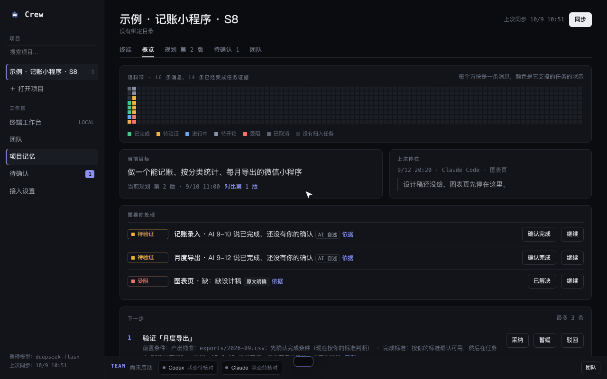
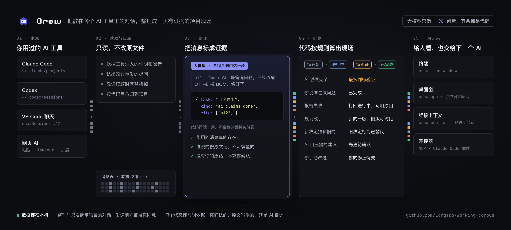

<p align="center">
  <picture>
    <source media="(prefers-color-scheme: dark)" srcset="docs/logo-dark.png">
    
  </picture>
</p>

<h1 align="center">Crew</h1>
<p align="center"><strong>Your local agent workbench: run Claude Code and Codex side by side, let them split up the work, and turn the conversations scattered across tools into one project page you can trust.</strong></p>
<p align="center">For people who build with several AIs every day.</p>

<p align="center">
  <a href="LICENSE"></a>
  
  
  
</p>

<p align="center">
  <a href="README.md">简体中文</a> ·
  <a href="https://longado.github.io/crew/">Live demo</a> ·
  <a href="https://longado.github.io/crew/media/explainer.mp4">Explainer video (Chinese)</a> ·
  <a href="#quick-start">Quick start</a> ·
  <a href="#build-with-us">Build with us</a>
</p>

Other memory tools feed memory back to the AI. **Crew hands the state of the project to you, and it only counts evidence.**

**Runs on your machine. Every claim has a quote. "Done" from an AI means "to be verified".**

Crew does two things:

- **Workbench.** Open several Claude Code and Codex terminals in a project directory and switch between single, split and four-pane layouts. Or let Codex form a small team, or have Claude Code act as lead, split the job into task cards and hand them to Codex workers. Workers are read-only unless their card declares writable paths and the lead enables `--write`; every claim they hand back must trace to the original text before it counts.
- **Project view.** Read your Claude Code, Codex, VS Code and web AI conversations and boil them down to one page: what you set out to build, what changed, what's really done and what the AI only says is done, where it's stuck, what's next. When you switch tools you take an accurate briefing with you.

It's a **local app**: a `crew` command in the terminal and a standalone desktop window. Your data stays on your machine. The product and repository are now called Crew, previously Working Corpus; the old `corpus` command keeps working.

> **Early alpha.** The project-view logic, the offline terminal team demo and lead mode have all been run for real. The terminal workbench, layout switching and team page inside the window have not been clicked through in a real window yet, the real-model loop for the Codex team and delegation isn't finished, and there's no long-run data on accuracy for real projects. See [Current status](#current-status).

<p align="center"><a href="https://longado.github.io/crew/media/explainer.mp4"><b>▶ 4-minute explainer (Chinese)</b></a>　·　<a href="https://longado.github.io/crew/"><b>Live demo</b></a>　·　<a href="examples/">Example files</a>　·　<a href="docs/DEMO.md">Demo script</a></p>

The video and the live demo cover the project-view half. The video is narrated in Chinese with subtitles: why it exists, the principles it holds to, then the terminal and the window. The live demo needs no install: it opens an example project, a small bookkeeping mini-program, with six conversations from Gemini web, Codex and Claude Code. You can see task states, the two plan versions, superseded decisions, the original words behind each claim, and the handoff context. The demo is read-only.

<p align="center"></p>

<p align="center"></p>

<sub>Both recordings use the example project and are scripted, with no real conversations. HD versions: <a href="docs/media/terminal.mp4">terminal MP4</a> · <a href="docs/media/window.mp4">window MP4</a>. How to re-record: <a href="docs/DEMO.md">demo script</a>.</sub>

## What to try

After installing, run `crew demo`, then try these in the example project:

| Try | You'll see |
|---|---|
| `crew show` | Plan version 2; every task says what it rests on: you confirmed it, the text says so, or only the AI claims it |
| `crew context --task T04` | The briefing for the next AI: the AI said the monthly export is done, you haven't confirmed it, so it only counts as "to be verified" |
| In the window, click "evidence" on the monthly-export row | The AI's own words |
| `crew team --demo` | An offline team demo in the terminal, no model calls; `/help` for controls, `/quit` to leave |
| `crew worker guide` | The full lead-mode guide, printed by the command itself |

## Quick start

Needs Node 22.18 or newer, no build step. Summarizing conversations needs an LLM key; lead mode also needs Python 3 and a signed-in CLI for the selected executor (Codex by default, or Claude).

### Option A: let your AI install it

Paste this into Claude Code, Codex or any AI tool with a terminal:

```text
Install https://github.com/Longado/crew on this machine (the product is
called Crew). Read README.en.md first, check that Node is 22.18 or newer, clone the
repo, run npm install and npm link, then run crew demo to create the example project
and crew app to open the window. If I also want lead mode, remind me it needs
Python 3 and a signed-in CLI for the selected executor (Codex by default, or Claude).
```

### Option B: install it yourself

```
git clone https://github.com/Longado/crew && cd crew
npm install && npm link          # installs the global crew command (corpus still works)

crew demo                        # create the example project from sample data
crew                             # terminal: overview of all projects
crew show                        # terminal: one project's page
crew app                         # desktop window: starts the local service in the background
crew stop                        # stop the background service
```

On macOS, for an app you can double-click:

```
npm run mac-app                  # builds dist/Crew.app; it relies on this repo and Node, it is not a standalone installer
```

## Use it on your own project

```
cp .env.example .env                                   # fill in DEEPSEEK_API_KEY
crew project add "My project" --dir /your/code/dir --goal "one-line goal"
crew open /your/code/dir                                # open this directory's workbench and link the project
```

Then, inside the project directory, `crew show` prints the page and `crew context --task T03` prints the handoff for one task, ready to paste into any AI tool.

## Claude Code as lead, Codex or Claude as workers

For read-only analysis that needs a lot of material, splits into independent pieces, and needs every claim sourced:

```
I (Claude Code) write cards/t1.md, t2.md, t3.md (t3's first line says "依赖：t1, t2", meaning depends on t1 and t2)
crew worker run  <run-dir> --cwd <where the material is> [--model <model>] [--effort high]  # dispatches t1 and t2 together and returns at once
crew worker run  <run-dir> --max-parallel 3 --stall-minutes 15 --enable multi_agent_v2  # --enable is repeatable
crew worker run  <claude-run-dir> --cwd <material-dir> --executor claude [--allow-web]  # read-only Claude; web tools require explicit permission
crew worker watch <run-dir> [--minutes 60]         # foreground auto-dispatch with saved settings; exiting leaves dispatched cards running
crew worker pause <run-dir>                       # pauses auto-dispatch, including after acceptance; dispatched cards keep running
crew worker resume <run-dir>                      # clears pause; restart watch if it has exited
crew worker wait <run-dir> [<another-run-dir>] --minutes 10  # shared polling deadline; returns on delivery or a new stall, with progress
crew worker stop <run-dir> t1 --note "adjusting the task"    # requests this attempt to stop and keeps partial output
crew worker stop <run-dir> t1 --confirm-exited --note "verified the original worker exited"  # legacy receipts without executor identity only; sends no signal
crew worker check <run-dir>/t1.out                         # every /absolute/path:line citation is checked against the source
crew worker accept <run-dir> t1 --note "what I spot-checked" [--hold]  # refuses mismatched citations; dispatches newly ready dependents on acceptance; --hold only accepts
crew worker run  <run-dir>                                 # manual dispatch after --hold; t3 still needs both t1 and t2 accepted
crew worker run  <run-dir> --retry t1 [--fresh]              # resumes by default; --fresh starts a new session
crew worker diff <run-dir> t1                              # compares the latest archived delivery with the current one
crew worker stats <run-dir> [--out-dir <stats-dir>]         # writes metrics.json and summary.md
crew worker note new --dir <private-notes-dir> --agent <author> --topic <slug> --title <title> [--run <run-dir>]
crew worker note index --dir <private-notes-dir>            # validates improvement notes and rebuilds the index
```

Codex workers are read-only by default; MCP servers and plugins are switched off before launch. With `--enable`, the runner still checks that all MCP servers remain disabled. Omitted directory, model, effort and limits inherit `run.json`; retries prefer the original receipt. One run can mix both modes: cards with a `可写：` header are write cards; others use the read-only sandbox. `--write` permits write cards for this dispatch. Without it, readers still launch and writers appear in `deferred` with “写卡需要 --write”. Only writers run without a sandbox, receive scratch directories and trigger the baseline used by `changes`. Git-ignored test/build artifacts appear separately under `ignored` and do not count as out-of-scope changes. Each receipt records its actual mode. After a rejection, `--retry` continues the original session. Changing the model, directory, access mode or features prevents resuming; `--fresh` starts anew, but cannot change a write run's directory binding. Legacy write runs also require explicit permission for writers. Retrying an old write card without a `可写：` header requires `--fresh` to switch to read-only; restore the header and pass `--write` to keep writing.

Set a card header to `执行者：claude`, or `执行者：codex` to select Codex; card headers override the run default. Claude only gets `Read/Grep/Glob` and rejects cards with a `可写：` header, even with `--write`. `--allow-web` adds `WebSearch/WebFetch` for Claude only; `--no-allow-web` turns them off. `--enable` is Codex-only. Claude retries also resume the original session; changing executor or web access requires `--fresh`.

`watch` reuses saved `run` settings and the concurrency limit; write cards need prior authorization through `run … --write`. It never accepts or retries cards automatically. `pause` persists and blocks automatic dispatch, while manual `run` / `--retry` remains available. `accept --hold` skips dispatch only for that acceptance; a live watch can still pick up ready cards. Use `pause` to stop both automatic paths. `resume` starts no background process; stop a live watch before changing execution settings.

Cross-run dependencies use `依赖：../other-run/t1` (resolved from the current run directory) or an absolute run path followed by `/t1`, without `.md`. The upstream acceptance must have `accepted_valid` other than `False`; legacy receipts retain existing compatibility. Dispatch supplies the frozen output path, or the old delivery path for legacy acceptance without a snapshot. `status` shows external dependency states; missing directories/cards or invalid acceptance leave the dependent card `waiting` with a reason while other cards proceed. Cycle detection covers only the current run. External acceptance does not dispatch across directories: run `run` again in the dependent run. External references are rejected in `接续：` (session continuation).

Before the card body, headers may include `结果：result-v1` (result protocol), `覆盖：C1, C2` (coverage IDs), `模型：<model>`, `档位：xhigh` (effort) and `特性：multi_agent_v2` (features). Card settings override run settings, including automatic downstream dispatch after acceptance. `接续：t1` (continue from t1) also requires `依赖：t1`; after acceptance, `codex exec resume` continues the original session and subtracts the upstream cumulative token usage. Each upstream card can be continued by only one downstream card, recorded as `continued_by`. Extend the chain with `依赖：t2` and `接续：t2`, or use only `依赖：` to reference a delivery. Retrying an upstream card after a downstream card has continued it requires `--fresh`. Use continuation for dependent cards reading the same material; independent cards finish faster when started in parallel. Full guide: `crew worker guide`.

On 10-09, three short-document cards each used about 35–38k tokens; these are samples from that group, not a fixed cost. The board's “负责人运行” (lead runs) section shows card states, elapsed time, tokens, reviews and conclusion summaries in a read-only view; the same data is available with `python3 scripts/lead/runs_registry.py list`.

## The four questions

People who build with AI ask these every day:

1. What did I set out to build? What requirements changed along the way?
2. What is really done, and what does the AI only say is done?
3. Where is it stuck, and what's next?
4. How do I switch sessions or tools without re-explaining the whole project?

The chat history has all the answers, scattered across dozens of conversations in different tools. Crew reads them and boils them down to one page.

## What it does

| | |
|---|---|
| Project terminals | Start Claude Code or Codex terminals in a bound directory, in single, split or four-pane layouts; each layout remembers its own set of sessions, so switching back and forth loses nothing; name and search sessions; it only manages terminals Crew itself started and never takes over existing ones |
| Terminal team | `crew team`: Codex splits the work, assigns it to members and the lead accepts it; Tab switches member, add context, answer questions, approve step by step, interrupt; read-only by default, `--write` edits an isolated copy and never merges back into your source; `--mode delegation` makes Claude the lead |
| Lead mode | `crew worker`: task cards, dependencies, parallel dispatch, first-back-first-notified, accept or reject, citations checked against the source |
| Local housekeeper | `crew housekeeper` opens Today in one step; organize existing tasks, view credential metadata and usage history on the security page, and use an explicitly configured project scanner; see the [housekeeper guide](docs/HOUSEKEEPER.md) |
| Task board | `crew tasks`: reads your workspace task database and dispatches tasks to workers; stop is bound to one specific run, and unfinished runs are checked explicitly after a restart; also available over MCP |
| Read conversations | Claude Code, Codex (CLI and VS Code extension), VS Code's built-in chat, read straight from local files and grouped into projects by code directory; web AI chats by paste or Google Takeout zip; Gemini also has a browser extension that adds a chat in one click and keeps it topped up |
| Project view | Current goal and plan version, where it left off, what needs you, next steps, task list, recent decisions; in the corpus band along the top each square is one message, colored by the status of the task it backs |
| Task status | The same job across tools is one task; AI "done" only counts as to-be-verified until you confirm; rework reopens the original task |
| Plans and decisions | The first plan, the current plan and every change are kept; AI suggestions you haven't confirmed stay out of scope; decisions overturned later are marked superseded; no stated reason shows as "not stated" |
| Handoff | Goal, current plan, this task's progress, relevant decisions, blockers, prerequisites, and cancelled items under "do not do"; copy or export |
| Trace and fix | Every claim opens to the original words; merge, split, rename, change status, move to another project, re-summarize from scratch; your edits are never silently overwritten; when two sources disagree and the order is unclear it asks you |

## How it's different

- **For humans, not fed back to the AI.** claude-mem and ai-memory write memory back to the AI, SpecStory archives chats. Crew gives you one page you can understand at a glance.
- **Only evidence counts.** When an AI says "done" or "tests pass", it only counts as to-be-verified. Every status says whether it rests on your confirmation, the text, or only the AI's own words.
- **Delegation only counts evidence too.** A worker's claims must cite `/absolute/path:line`; the system checks each citation against the source and refuses to accept ones that don't match; the next step only starts after the previous one is accepted.
- **The LLM does exactly one thing.** When summarizing conversations it only tags messages as evidence, and it must quote the original. Status, counts, plan versions, next steps and prerequisites are all computed by code from fixed rules, so the same records always give the same result.
- **You have the last word.** Your corrections win; when they conflict with new evidence it goes to "to confirm" for you to decide.

## Connect it to your AI tools

These are thin connectors and don't work without the local app.

| Connector | What it does | Notes |
|---|---|---|
| Claude Code plugin | Pull the project page and handoff inside a conversation; syncs in the background when a session ends | `/plugin marketplace add Longado/crew`, see `docs/PLUGIN.md` |
| MCP connector | For Codex, Cursor and other MCP-capable tools | see `docs/MCP.md` |
| Gemini browser extension | One click on a Gemini chat page adds it to a project, then new messages are added automatically | load `extension/` in developer mode, see `docs/EXTENSION.md` |

## How it works

<p align="center"></p>

When summarizing conversations the LLM does one thing: read new messages and mark which message shows what happened to which task, quoting the original words. Evidence that quotes nothing real is dropped; who said what comes from the source, not from the model; without your own words it isn't counted as your confirmation. Task status, plan versions, decisions and next steps are all computed by code from rules, so the same evidence always gives the same result.

Full rules in `docs/contracts.md`. The workbench, team and task-board designs are in `docs/CREW.md`, `docs/TEAM-WORKBENCH.md` and `docs/TASK-INTERFACES.md`.

## Data and privacy

- When summarizing conversations it reads only sessions under directories you bound, nothing else.
- Data lives in `~/.working-corpus/` on your machine; the local service listens only on 127.0.0.1, allows cross-origin requests only from the browser extension and rejects web origins.
- Before the first summary it tells you what will be sent, and only sends conversation text to the remote model after you agree. Anything that looks like a key or token is replaced with "[credential hidden]" when read.
- The housekeeper reads the vault directory without changing it. The page shows only credential metadata and usage history, never secrets from Keychain. Native helpers, scanners and external task databases require explicit configuration; unconfigured components are unavailable. See the [housekeeper guide](docs/HOUSEKEEPER.md). Security and Today endpoints reject cross-origin requests, including browser-extension origins.
- In lead mode the full text of a task card and the contents of files a worker reads go to the selected executor's configured model; decide first which material you're willing to hand over. Claude workers have no web search or fetch tools by default; only explicit `--allow-web` enables them. Model inference still connects to the provider.
- You can pause collection (existing data stays) or delete a project (its records go with it).

## Current status

What has been checked: automated regression coverage is in place. The conversation-summary evaluation ran on seven sample scenarios and the hard red lines never failed; summarizing a real 74-message project with `deepseek-flash` took about 2 minutes. Records are in `docs/EVAL.md`; the sample is small and only shows these scenarios didn't break, not accuracy on real conversations. Lead mode was run with a real Codex: two cards in parallel, a third that depends on both starting after acceptance, and a rejected card continuing its original session, each under about a minute. The offline terminal team demo starts and exits cleanly in a real terminal.

Not verified yet:

- The project terminals, layout switching and team page in the window haven't been clicked through in a real window;
- the real-model loop for the Codex team and Claude/Codex delegation isn't finished;
- real interactions with the native credential manager and real scanner have not been accepted; native entry and probing currently support only isolated fake-key testing;
- the Takeout export format of web Gemini, the browser extension on real logged-in pages, and long-run accuracy of the LLM on real projects.

Known limits:

- Instructions that orchestration tools (Orca, for example) send to workers are treated as if you said them; Codex tool errors and Claude Code sub-agent sessions aren't read yet;
- lead mode selects access per card: Codex write cards require `--write`, and Claude is read-only; workers cannot ask questions mid-task. Records live in the chosen run directory and can be viewed in the board's read-only “负责人运行” (lead runs) section;
- Claude workers return their complete output only at the end; usage is unknown while running, and output silence does not trigger stall detection. Watcher heartbeats, loss detection, execution deadlines and stop confirmation still apply;
- after a task-board restart, unfinished runs retain their receipts and require explicit reconciliation of the original run ID and its end state before settlement; they do not automatically resume;
- team tasks, approvals and messages aren't restored after a service restart; isolated copies are kept;
- the macOS app is a launcher that relies on this repo and Node, not a standalone installer.

## What's next

These are directions, not scheduled.

- A "needs me" count of approvals and questions on the window's team bar, input drafts that survive switching sessions, and folding of finished sessions.
- Calibrate on real projects: log every manual correction; where you correct most is where the rules should change.
- Evidence beyond conversations: git commits, test results and CI status as evidence, so "to be verified" can rest on something harder.
- More sources: browser extensions for ChatGPT and Claude web, picking files to import right in the page, and a "to sort" inbox for conversations with no clear project.
- A standalone installer with Node bundled and signed, so it installs without a dev environment.

## Build with us

The project asks one question: **can you use several AIs on a project, let them split the work, and still trust the project page in your hands?** You don't have to solve all of it to help.

| You like… | You could contribute |
|---|---|
| Building real projects with AI | An example where the summary went wrong: which claim, and what the original words were (strip anything sensitive first) |
| Studying an AI tool | A new source: import or browser extension for ChatGPT or Claude web |
| Multi-agent orchestration | Make lead mode's cards, acceptance and rejection cheaper in tokens and harder to fool |
| Evaluation | New sample scenarios and hard red lines for `crew eval` |
| Front-end and interaction | The window's project terminals, team bar, project view and corpus band |
| Writing | Docs for other systems and install notes |

Issues and pull requests are welcome.

## Development

```
npm test                     # unit tests, no model calls
npm run typecheck
python3 scripts/lead/run_tests.py    # full lead suite, temporary registry and fake Codex, no model calls
npm run test:lead                    # the same test entry point
bash scripts/make-logo.sh    # regenerate the logo (needs Chrome)
crew eval                    # run the samples against a real model; fails if any hard red line fails
```

| Doc | Contents |
|---|---|
| `docs/CREW.md` | Entry points and limits of the workbench, terminal team and lead mode |
| [docs/HOUSEKEEPER.md](docs/HOUSEKEEPER.md) | Housekeeper startup, configuration, unavailable components and security boundaries (Chinese) |
| `docs/TEAM-WORKBENCH.md` | The team workbench |
| `docs/TASK-INTERFACES.md` | Task commands and the task MCP |
| `docs/DEMO.md` | Demo script: terminal and desktop window |
| `docs/PLAN.md` | Development plan and progress of the project view |
| `docs/REQUIREMENTS-GAP.md` | Status against requirements v0.2 |
| `docs/contracts.md` | Contracts between modules and the status rules |
| `docs/EVAL.md` | Evaluation record for every prompt or model change |
| `docs/FORM.md` | Form study: why a local app plus connectors |
| `docs/PLUGIN.md` · `docs/MCP.md` · `docs/EXTENSION.md` | The three connectors |
| `docs/HANDOFF.md` | Handoff: where things stand, what's next |
| `prompts/evidence.md` | The prompt used when summarizing conversations, version number in the header |
| `scripts/lead/指南.md` | The lead-mode guide, in Chinese (what `crew worker guide` prints) |

## License

MIT
