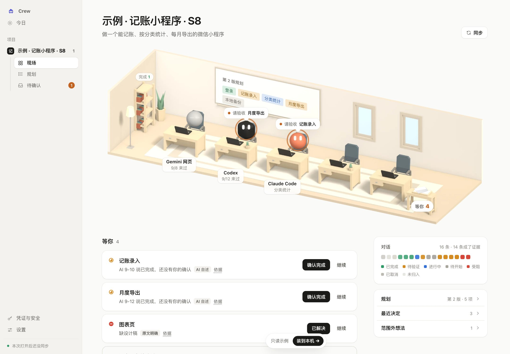
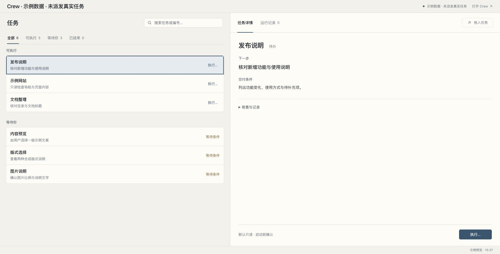
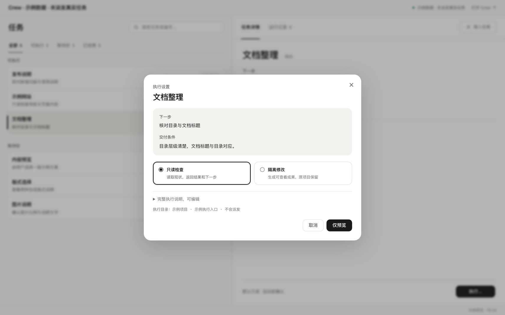

<p align="center">
  <picture>
    <source media="(prefers-color-scheme: dark)" srcset="docs/logo-dark.png">
    
  </picture>
</p>

<p align="center"><strong>本地 Agent 工作台：把一个项目的上下文、任务卡和验收放在一起，派给 Codex／Claude 去做。</strong></p>
<p align="center">给同时用 Codex、Claude Code 和网页 AI 推进同一个项目的人。</p>

<p align="center">
  <a href="LICENSE"></a>
  
  
  
  
</p>

<p align="center">
  <a href="README.en.md">English</a> ·
  <a href="https://longado.github.io/crew/">在线演示</a> ·
  <a href="#快速开始">快速开始</a> ·
  <a href="#一起做">一起做</a>
</p>

一个项目同时用几个 AI 时，讨论在 Claude Code 里，执行在 Codex 里，结论散在聊天记录里。Crew 把它们放回同一个本地工作台：负责人拆任务卡，Crew 按依赖派发，执行者交回带出处的结果，验收过的才推进下一步。

**在你的电脑上运行 · 默认只读派发 · 验收后才推进下一步**

## 是什么

Crew 做三件事：

- **看清项目现场。** 汇集项目对话、规划、决定和任务依据，区分已完成、待验证和受阻；给下一个 Agent 准备续接上下文。
- **编排 Agent 任务。** 负责人模式下，把目标拆成任务卡，写明依赖和可写范围；Crew 派给 Codex 执行，也支持 Claude 只读执行。独立的卡并行，交回的结果可以核对、退回续改，验收后再派依赖它的下一张。在任何终端里都能用，包括 Orca。
- **把材料变成可讨论的下一步。** 会议记录、访谈、研究笔记与当前项目对照，得到带材料原话和项目依据的建议，逐条采纳、暂缓或不采纳，再导出选中的建议。

> **早期版本（0.3.0 Alpha）。** 负责人模式已用于作者自己的多轮开发和研究编排；Claude 执行者、原生凭证管家的真实交互还没有完整验收，也还没有外部用户的使用结论。进展见 [交接记录](docs/HANDOFF.md)。

## 截图

以下截图都用示例数据，没有派发真实任务。

<p align="center"></p>
<p align="center"><sub>项目现场：<a href="https://longado.github.io/crew/">在线演示</a>里的示例记账项目，看到任务状态、上次停在哪和下一步。</sub></p>

<p align="center"></p>
<p align="center"><sub>任务看板：可执行的和等你确认的分开放。这张是示例数据的静态页。</sub></p>

<p align="center"></p>
<p align="center"><sub>执行设置：派发前选只读检查或隔离修改，默认只读。</sub></p>

## 任务编排怎么走

负责人拆任务卡 → Crew 按依赖派发 → Codex 执行 → 检查与验收 → 推进下一步。

| 你 | Crew 会 |
|---|---|
| 在运行目录的 `cards/` 里写任务卡，首行写 `依赖：t1` | `crew worker run` 只派依赖都已验收的卡，独立的卡并行，派出就返回 |
| 等结果 | `crew worker wait` 有卡交回或疑似卡住就返回，附上进度 |
| 检查交付 | `crew worker check` 把交付里的 `/绝对路径:行号` 出处对回原文 |
| 验收 `accept` | 出处对不上就拒绝验收；通过后自动派出这次解锁的下游卡 |
| 退回 `reject` | `--retry` 接着原会话改，不从头重来 |
| 要改文件 | 卡头声明可写路径，派发时显式加 `--write`；Claude 执行者只读 |

完整规则（卡头写法、接续、`watch`／`pause`、跨运行依赖）由 `crew worker guide` 打印，和命令放在一起维护。更多见 [工作台说明](docs/CREW.md#负责人模式claude-code-拆卡codexclaude-执行者干活)。

## 可以试试

下面几条都不调用模型。

| 试试 | 看到什么 |
|---|---|
| `crew team --demo` | 终端团队界面：成员、提问 Q1、审批 A1，全部是演示，`/quit` 退出 |
| `crew demo`，再按提示运行 `crew show --project <编号>` | 示例记账项目：6 项任务的状态、阻塞原因和下一步 |
| `crew app` | 在独立窗口里打开本地工作台；`crew stop` 停掉后台服务 |
| `crew worker guide` | 任务卡、派发和验收的完整用法 |
| `./bin/crew intake demo` | 材料流程：生成一张带出处的建议卡，A1、A2 待你决定；只需 Python |

## 快速开始

需要 macOS（Linux 只跑过材料流程的测试）、Git、Node 22.18+、Python 3.9+。真实派发需要已安装并登录的 Codex 或 Claude Code；模型处理会用到对应服务，开源许可不等于模型服务免费。

### 方式 A：让你的 AI 帮你装

把下面这段贴进 Claude Code 或 Codex：

```text
帮我在本机装好 Crew（https://github.com/Longado/crew）。
1. 先读仓库的 README.md，了解它做什么、需要什么。
2. 检查 node -v 是否 ≥ 22.18、python3 --version 是否 ≥ 3.9，不满足就告诉我，不要自行升级。
3. 克隆到我指定的目录，运行 npm ci 和 npm link。
4. 运行 crew team --demo 让我看终端团队演示，再运行 crew worker guide 给我讲任务卡怎么写。
5. 提醒我：真实派发要先登录 Codex 或 Claude Code；默认只读，改文件要我明确加 --write。
```

### 方式 B：自己装

```sh
git clone https://github.com/Longado/crew && cd crew
npm ci
npm link          # 之后可直接用 crew 命令
crew app          # 打开本地工作台
crew worker guide # 任务卡、派发和验收用法
```

只想先看材料流程，不装 Node：

```sh
git clone https://github.com/Longado/crew && cd crew
./bin/crew intake demo
```

Claude Code 插件：在 Claude Code 中运行 `/plugin marketplace add Longado/crew`，后续步骤见 [插件说明](docs/PLUGIN.md)。

## 材料变行动

访谈讨论如何补充发布说明草稿的出处与适用版本，并明确暂缓自动发布。Crew 把材料原话和项目依据放在建议旁，你可以采纳“先检查发布说明”，保留“暂缓自动发布”的建议等待决定，再导出已采纳的下一步。

### 先试预设示例

只需 **Python 3.9+、Git 和 macOS／Linux**，不需要 Node/npm、模型账号或私人数据库。`./bin/crew intake demo` 用合成材料和预设分析，不调用模型，演示不代表模型分析质量。完整走一遍查看、采纳和导出：

```sh
CREW_CARD="$(./bin/crew intake demo --json | python3 -c 'import json,sys; print(json.load(sys.stdin)["cards"][0]["json"])')"
./bin/crew intake review "$CREW_CARD"
./bin/crew intake review "$CREW_CARD" --action A1 --decision accept --note '用于下轮讨论'
./bin/crew intake export "$CREW_CARD"
```

首次生成的建议都是 `pending`。也可用 `--decision defer` 暂缓或 `--decision dismiss` 不采纳，选择保留历史。导出只包含当前卡片中已采纳的建议及其出处，**尚未执行**；可加 `--format json`。重复演示保留之前的选择。

### 用自己的资料和项目

先用仓库内的合成资料查看输入范围：

```sh
./bin/crew intake examples/intake/meeting.md --workspace examples/intake --catalog examples/intake/projects.json --dry-run
```

把资料放进自己的目录，按 [项目清单契约](docs/INTAKE.md#项目依据) 写 JSON，再将命令中的材料、`--workspace` 和 `--catalog` 改为对应路径。项目路径相对于 `--workspace`，不是清单文件；候选项目的当前交接或说明文件提供判断依据。已有任务库可通过 `--database` 兼容接入，不是首次使用的前提。

项目清单的最小结构如下；`id` 为唯一正整数，`name` 和 `path` 必填，`description` 可省略，`status` 默认为 `active`（也可为 `paused`）。

```json
{"version":1,"projects":[{"id":1,"name":"Release notes","description":"Draft release notes with sources","path":"projects/release-notes","status":"active"}]}
```

去掉 `--dry-run` 才开始真实分析，需要已安装并用订阅账号登录的 **Claude Code**。材料和候选项目片段会发送给该服务。材料入口不使用 API key。

支持 UTF-8 `.txt`／`.md`，目录只读直接子文件，不递归；PDF、音频和视频先转文本。当前提示词和卡片主要为简体中文。引用校验能发现无效出处，不能保证讲者主张真实或建议合适。采纳的建议目前要另行安排执行，不会自动创建任务或派发。详见 [材料流程说明](docs/INTAKE.md)。

## 数据与边界

- 工作台数据默认在 `~/.working-corpus`（可用 `CORPUS_HOME` 改）；负责人模式的任务卡、交付和验收记录留在你指定的运行目录里。
- 材料流程的真实结果默认在 `~/.local-sensitive/crew-intake/`，演示在 `~/.local-sensitive/crew-intake-demo/`；`--output` 可指定其他本地私有目录。这里保存原文快照、缓存、卡片、决定和运行记录，目录权限和备份要自己管理。
- 派发默认只读；改文件要卡头声明可写路径并显式 `--write`。Crew 不接管已有的 Orca 或原生终端会话。
- 真实派发和真实分析会使用远程 Codex／Claude 服务，并非所有处理都在本机完成。
- [在线演示](https://longado.github.io/crew/)页面带 VibeCafé 的匿名访问统计（UV/PV）；本机运行的 Crew 不加载这个脚本。
- 没有自动监测收件箱、PDF/音视频解析或材料网页入口。

[工作台](docs/CREW.md) · [团队工作台](docs/TEAM-WORKBENCH.md) · [本地管家](docs/HOUSEKEEPER.md) · [MCP](docs/MCP.md) · [Claude Code 插件](docs/PLUGIN.md) · [旧版演示说明](docs/DEMO.md) · [0.3.0 版本说明](docs/releases/0.3.0.md)

## 一起做

**几个 AI 一起干活时，怎样让人只在关键处拍板，又不丢上下文？**

| 你喜欢…… | 可以贡献 |
|---|---|
| 工作流设计 | 采纳的材料建议怎样接回任务卡（现在采纳只导出，不建任务） |
| 文件处理 | PDF、音频、视频转文本后接进材料流程 |
| Claude Code／Codex | 用 Claude 执行者真实跑一轮，反馈哪里接不上 |
| 终端界面 | 把终端团队做成终端插件（目前只是方向，还没实现） |
| Linux | 在 Linux 上跑完整工作台并报告问题 |

最有用的反馈是一次具体使用过程：任务怎样拆、哪里接不上、哪份交付还不值得验收。请用不含私人资料的例子。欢迎提 [issue](https://github.com/Longado/crew/issues) 或 pull request，提交前读 [贡献说明](CONTRIBUTING.md)。

## 开发

```sh
npm ci
npm run typecheck
npm test                                                        # 含本地进程和浏览器启动，宜在隔离环境运行
python3 scripts/lead/run_tests.py                               # 负责人模式
python3 -B -m unittest discover -s scripts/intake -p 'test_*.py' # 材料流程
blender -b -P scripts/office/render.py -- <Furniture Kit 的 glb 目录>  # 重渲办公室场景图，输出到 web/office/
```

## 许可

[MIT](LICENSE)。办公室场景用 [Kenney Furniture Kit](https://kenney.nl/assets/furniture-kit)（CC0）的模型渲染。
