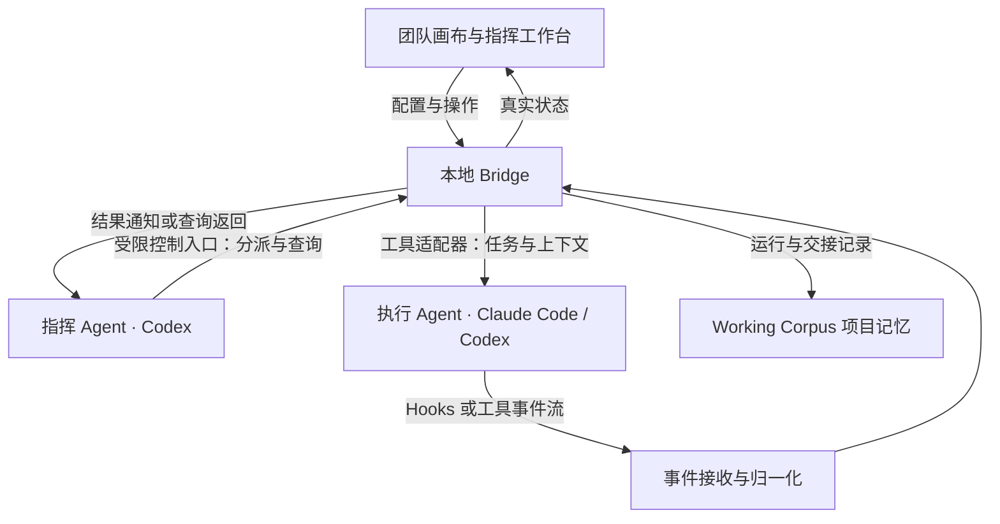

# Working Corpus 多 Agent 团队体验 Implementation Plan

> 后续执行入口已更新为 [团队工作台执行计划](../../2026-09-29-team-workbench-plan.md)。本文件保留原设计与技术任务作参考；当前实测状态以新计划和接入报告为准。

> 执行约定：按用户要求直接推进，每一步给出实际产物和验收结果；由实现需要决定检查方式，不强制套用 executing-plans 或 TDD Skill。

**Goal:** 让用户在两个或多个终端中分别使用的 Codex、Claude Code 等独立 Agent 会话互相发送任务、提问和回传成果，并能图形化组织团队、查看协作和介入。

**Architecture:** Working Corpus 以本地 Hooks + Bridge 连接现有 Agent 工具：Hooks 或工具事件流报告发生了什么，Bridge 负责身份绑定、任务投递、上下文交接和结果回传；画布读取同一份运行状态。推理和工具执行继续由原 Agent 承担，项目记忆复用现有任务、决定、依据和续接上下文。

**Tech Stack:** 当前仓库采用 Node.js、TypeScript、SQLite 和原生浏览器 JavaScript/CSS。本计划不决定新增画布库或重写前端；运行适配方式在能力验证后确定。

---

日期：2026-09-29。版本：v0.3，明确独立终端会话的双向协作场景。状态：完整产品设计保留，通信入口原型已验证；正式 Bridge 和产品界面尚未实现。

核心场景已明确：用户在 terminal A 与 Codex 对话，在 terminal B 与 Claude Code 对话，希望这两个以及更多会话直接协作。Bridge 连接的是明确绑定的独立 Agent 会话；计划和任务作为它们交换的内容。用户仍然可以在原终端与各 Agent 单独对话。

本文是 PM 层面的完整体验与交付计划。开发轮次的具体代码改动需在运行接口验证后细化，本文不把未验证的第三方能力写成既成事实。

Channel + Bridge 的任务顺序、文件职责和验收条件见[通信接入任务规划](2026-09-29-channel-bridge-tasks.md)。该任务规划细化本文件的通信部分，不替代完整产品范围。

## 1. 这次迭代要解决什么

用户已经能同时打开多个 Agent，却仍要亲自维护它们之间的关系：谁负责拆解目标、谁执行、谁等谁、上下文怎么传、什么结果才算完成。会话数量增加后，人容易成为任务转发和状态核对的瓶颈。

这次把 Working Corpus 从“整理跨工具项目现场”扩展为“组织并运行跨工具 Agent 团队”。原有项目记忆继续承担共同记录，让团队运行结束、成员更换、会话中断后仍能接着工作。

主要用户是像当前用户这样，同时使用 Codex、Claude Code 等工具、愿意配置团队的个人创作者或开发者。尚未做其他用户访谈，不把这个案例外推为市场规模或普遍需求。

### 当前已表达的需求

- 一个上游 Agent 可以指挥多个下游 Agent，成员可以来自不同工具。
- 可以明确建立团队、职责和上下游关系，并用图形看到这些关系。
- 能配置一套可实际工作的环境，不用每次重新组织。
- 希望探索产品交互形式，再形成开发计划。
- 用户已认可团队画布与指挥工作台方向，并明确以中间 Hooks 和 Bridge 实现跨 Agent 连接。
- 优先解决两个现有独立终端会话之间的双向交互；只在后台另开两个 Agent 不能代替此场景验收。接入需要重启／恢复会话时必须说明，并验证上下文连续性。

### 本计划采用的工作假设

- “无限换步”按语音转写的“无限画布”理解；用户随后表示尚未选定形态，希望 PM 比较后推荐。
- 主场景为本机、单个操作者、一个项目下的一支团队。
- 先完整设计组队到验收的体验，再按依赖顺序交付；静态画布不算完整产品交付。
- 优先把现有 Agent 工具连接到 Bridge；已有会话能控制就显式绑定，无法控制时可以通过受支持接口新建会话。接管 Orca 中正在运行的会话属于单独的能力问题，不默认可用。

## 2. 产品定位和体验原则

对用户的一句话：**给你的 AI 团队一个目标，看见分工、接力和结果。**

第一入口用更直接的表达：“连接我的 Agent”。用户选中 Codex 会话和 Claude Code 会话，加入同一团队，即可让其中一个向另一个提问、交任务和收结果。设置“谁指挥谁”是在连接之上的协作规则，不是发送第一条消息的前提。

产品中的“工牌”表示一个有稳定职责的成员。成员可以更换工具、模型或会话；它负责的任务和历史成果继续留在项目里。

1. 先看懂当前工作，再进入详细对话。首页应回答谁在做、卡在哪、需要我做什么。
2. 配置能运行。每种关系都有明确意义，配置检查通过才允许启动。
3. 原因可追溯。任务分派、上下文传递、失败和完成都能打开查看。
4. 自动执行遵守一次明确的任务授权；正常分派不逐次打断用户，目标或范围发生变化才请求决定。
5. 试验可重复。保存团队配置，保留每轮运行；重试或换人不会覆盖旧结果。

### 2.1 已确定的架构方向：Hooks + Bridge



| 部分 | 负责什么 | 明确的边界 |
|---|---|---|
| Hooks／事件接收 | 报告会话关联、工具观测、退出等所支持事件，快速入本地队列 | 不在钩子内长时间调模型或指挥其他成员；缺少某种事件就标明覆盖不足 |
| Bridge | 绑定身份、检查任务边界、持久化命令、路由、回执、交接、重连核对 | 不实现 Agent 的推理循环；不把收到命令等同实际开始执行 |
| 工具适配器 | 把统一命令转换为各工具实际支持的操作，报告能力与结果 | 不假设所有工具都支持向既有会话发消息、停止或恢复 |
| 项目记忆 | 保存目标、任务、决定、产物依据与续接背景 | 历史对话推断不能替代实时控制回执 |
| 画布和工作台 | 编辑团队，显示状态，进入会话和处理问题 | 不根据动画、终端标题或文字总结伪造运行状态 |

一个重要区别：Hook 是事件入口；向另一个 Agent 发任务仍需要可用的控制接口。仅安装 Hooks 不能证明已实现团队编排。

### 2.2 从用户角度看“接入”

接入页先检查工具，再让用户选择关联会话或新建会话。完成后显示具体能力，不只显示“已连接”。

- **可观察**：能收事件和读取记录，不能自动派单；适合作为旁观成员。
- **可执行**：能向明确会话投递任务、确认接收并收回结果；可以承担团队任务。
- **可控制的操作**：逐项列出新建、停止、恢复等能力，仅显示已验证可用的按钮。

成员实例必须显式绑定项目、运行、工牌和原生会话编号。同一目录可以有多个会话，目录不能作为唯一身份。Orca 的窗口只是可能的入口；操作入口与实际执行会话分别记录。

Bridge 初版作为现有本地服务的一部分运行，复用 SQLite；不引入独立消息中间件。UI 关闭后是否仍运行取决于本地服务状态，页面必须显示断连和最后更新时间。服务重启后先核对执行实例，再处理未完成命令。

### 2.3 第一条必须跑通的真实链路

以一个小型页面任务为验收载体，但最终交付范围仍覆盖第 5 节完整旅程：

1. 用户把 terminal A 的 Codex 和 terminal B 的 Claude Code 会话加入同一团队；若工具要求启用连接器后重启，则恢复指定会话并核对历史。已有会话不能静默替换为新的空白会话。
2. 指挥通过受限控制入口请求分派任务；Bridge 保存任务、接收成员、上下文版本和命令编号。
3. Bridge 投递给绑定的执行实例，分别记录“已入队”“已投递”“执行端已接收”。接收依据缺失时停留在相应状态。
4. 执行实例完成工作并提交产物；适配器和 Hooks／事件流回报可以证实的过程。会话结束事件本身不构成任务完成。
5. Bridge 保存结果，将其提供给指挥；支持可靠通知则通知，否则由指挥查询。具体方式随适配器能力确定。
6. 指挥汇总成果，画布显示任务进入待验证，用户查看产物后验收或退回。

这条链路不能靠人复制粘贴来通过验收。先验证 A 向 B 提问、B 回 A，再验证 B 主动向 A 提问；双方回复必须实际进入目标会话，不能只存到数据库或画布中。完成后增加第三个终端中的 Codex 执行成员，验证定向路由、并行任务、依赖与汇总。

### 2.4 Bridge 的最小数据约定

下列为拟定内部协议字段，工具原生事件名称在接入验证时映射，不假定各家具有相同 Hooks。

| 记录 | 必需内容 | 用途 |
|---|---|---|
| 实例绑定 | projectId、runId、memberId、provider、nativeSessionId、bindingVersion、capabilities | 确定指令发给谁；换人后拒绝旧绑定继续领取任务 |
| 命令 | commandId、runId、taskId、attemptId、fromMemberId、toMemberId、bindingVersion、kind、contextVersion、issuedAt | 分派／控制操作可追踪，重试可识别 |
| 事件 | eventId、provider、nativeSessionId、bindingVersion、kind、occurredAt、receivedAt、关联 commandId／attemptId | 去重、关联尝试，区别发生时间和收到时间；原始时间缺失时留空 |
| 交接内容 | 目标、范围、输入引用及版本、预期产物、完成条件、相关决定 | 接替者获得必要信息；不默认复制全部对话 |

Bridge 的入队回执和执行端回执分开记录。重复 commandId 返回已知结果；跨进程崩溃时无法确认是否已执行的命令进入核对状态，不盲目重发，也不承诺分布式“恰好一次”执行。

事件重复时不重复推进任务，迟到事件归回原尝试；提供原生序号时按序核对，没有时不靠时间戳强行推断所有先后。没有会话身份或无法关联到本轮的事件留在待关联记录，不更新成员状态。

控制入口绑定本轮身份和权限范围，执行成员只能回报自己领取的任务。事件接收要验证本地连接身份；外部网页不能仅凭能访问本机端口就派单。初版接收必要状态与产物引用，正文沿用现有采集机制按需读取，不传环境变量或凭证。

### 2.5 多终端之间如何交互

用户仍在原来的终端发起要求，例如：“让界面成员检查你提出的接口，回来后你再改方案。”Agent 调用桥接工具发送有目标的消息，接收方处理后通过回复工具回传，Bridge 将回复送回原发起会话。

面向 Agent 的最小操作为 `list_members`、`send_message`、`reply_message` 和 `get_message_status`（拟定名称，并非现有命令）。发件人由连接身份确定，不能靠模型在参数中自称用户或其他成员。自动派发可执行任务仍受已授权任务范围约束。

消息在 commandId 之外有 messageId 和 inReplyTo，区分提问、任务请求、结果和普通通知；普通回复不自动变成下一轮任务。技术接收回执不交给模型继续回复，避免两个 Agent 不停互相确认。每个协作请求配置往返次数与超时限制，达到限制转为待处理。

默认定向发送，不转发全部终端日志，也不默认向所有成员广播。接收方忙碌时优先排队到可处理边界；插入在途任务是明确的单独操作，具体表现以工具能力为准。用户在原终端的新指令优先；取消或改派后，旧协作消息不能重新激活已取消任务。

### 2.6 已核对的接入候选与验证缺口

核对日期：2026-09-29。只运行版本／帮助查询和读取官方文档，没有向现有会话发送消息、调用模型或修改配置。

| 方向 | 本轮核对结果 | 下一步必须实测 |
|---|---|---|
| Bridge → Codex | 本机 codex-cli 0.157.1 的 `codex queue --help` 明确支持按 thread UUID 或精确名称排队消息；官方 App Server 提供 `turn/start`、`turn/steer` 与事件通知 | 当前终端是否连接可用服务，按 UUID 投递是否进入原会话、忙闲处理及回传身份；不凭名称猜目标 |
| Bridge → Claude Code | 官方 Channels 支持向已运行会话推送事件，并通过回复工具双向通信；本机 Claude Code 版本为 2.1.284 | 本机账号／组织是否支持、如何启用自定义 channel、恢复原会话后是否正常收发 |
| Agent → Bridge | 两端通过受限 MCP 工具发消息／回复是拟定方案；现有 Corpus MCP 仍只读 | 独立控制连接器的身份绑定、作用域和消息关联，不修改只读接口的原承诺 |
| Hooks → Bridge | 已有 Claude 插件的 SessionEnd 同步入口可复用；其他事件逐项接入 | 事件覆盖、迟到／重复、断连；退出事件不代表成果完成 |

Codex 接入候选依据：[App Server 官方文档](https://learn.chatgpt.com/docs/app-server)。本机帮助中的 queue 命令是当前安装版本的能力说明，尚未实测投递。

Claude Channels 仍处于研究预览，使用需在会话中显式启用，受认证方式与组织设置限制；自定义 channel 的本地开发接入和正式分发方式不同。不能据此承诺所有账号或任意已打开终端均可直接接管。依据：[Channels](https://code.claude.com/docs/en/channels)、[Channels reference](https://code.claude.com/docs/en/channels-reference)。

建议优先验证原生消息入口。普通 MCP 工具供 Agent 主动调用，本身不等于能唤醒一个空闲会话；如只能手动查收，界面和验收都要明确是手动模式。通过非交互进程新建会话可作为另一路线，但不能冒充连接用户当前两个终端。首轮不以模拟键盘向终端粘贴作为主通道。

## 3. 交互形态的比较与建议

| 形态 | 适合的时刻 | 容易出现的问题 | 本方案取舍 |
|---|---|---|---|
| 自由无限画布 | 组队、调整关系、理解复杂协作 | 空白页难起步；随意连线不等于可执行；大图容易迷失 | 作为团队主视图，提供模板、自动排布和聚焦 |
| 固定流程画布 | 前后顺序稳定的任务 | 临时分派、返工和替换成员容易被硬塞进固定流程 | 用于任务依赖视图，不把所有工作固定成流水线 |
| 多终端平铺 | 深入某个 Agent 的操作过程 | 全局状态和交接关系仍要靠人记 | 从成员详情进入，不作为默认首页 |
| 列表或看板 | 看优先级、阻塞和成果 | 不直观表达指挥及协作关系 | 与画布共享数据，作为运行时的操作入口 |

**推荐采用团队画布 + 指挥侧栏，同一工作台支持“组队”和“运行”两个模式：组队时画布优先，运行时待处理事项优先。**

这是本轮 PM 推荐，尚未经过原型使用验证。无限画布提供空间自由，岗位、连线和运行操作保留明确含义；不把白板的所有编辑能力都带入产品。

用户首先看到一支可以修改的示例团队，或描述目标后生成团队草案。保留“从空白开始”，但不要求每个人手工画每个节点。

### 组队模式

中心放成员和指挥关系；右侧编辑选中成员；顶部设置目标、项目环境和运行条件。保存配置不会自动启动。自由移动仅改变布局，连接或修改职责才改变团队配置。

### 运行模式

保持原布局，成员卡片显示当前任务、状态和最近更新时间。右侧默认展示“需要你处理”，选择节点后展示成员详情；下方提供可收起的交接时间线。

不持续闪烁所有连线。选择成员或任务时才突出相关路径；新事件不擅自移动用户视口。提供“全览”“定位阻塞”“回到指挥”三个导航入口。

```text
┌ 项目 / 团队       本轮目标       组队 | 运行       启动 / 暂停分派 ┐
│ 项目与团队 │ 团队图 | 任务依赖 | 任务列表        │ 需要你处理  2 │
│            │                                    │              │
│ 当前运行   │          指挥 · Codex               │ 接口变更     │
│ 历史运行   │           /         \               │ 影响两个任务 │
│ 项目现场   │  界面 · Claude    接口 · Codex       │ 查看与决定   │
│ 成果       │       \             /               │              │
│            │           检查角色                  │ 待验收成果   │
├────────────┴────────────────────────────────────┴──────────────┤
│ 最近交接：接口契约 → 界面成员       查看内容 / 展开运行时间线     │
└───────────────────────────────────────────────────────────────┘
```

上图是布局草案，不代表已经实现的页面。检查角色可以由独立成员承担，也可以在任务完成后指定，无须每次创建一个常驻 Agent。

## 4. 用户需要理解的对象

| 对象 | 用户理解 | 生命周期与关系 |
|---|---|---|
| 项目 | 我正在做的事情及其长期记录 | 包含目标、决定、任务和多轮运行 |
| 团队配置 | 一套可复用的协作安排 | 包含成员岗位、职责、关系、环境要求；按版本保存 |
| 成员／工牌 | 团队里负责一类工作的角色 | 独立于会话；可以换工具或执行实例 |
| 会话 | 某个工具中的一次具体执行上下文 | 绑定成员和运行；关联旧会话不等于获得控制权 |
| 任务 | 有明确产物和完成标准的一项工作 | 可以跨会话接续；同一任务可有多个执行尝试 |
| 一轮运行 | 用某个团队版本完成一次目标 | 固定配置版本、范围和环境，记录分派与成果 |
| 环境 | 团队工作所依赖的目录、工具及资源 | 明确成员可访问范围、写入位置和就绪状态 |
| 交接 | 成员之间传递一次工作输入或结果 | 记录发送者、接收者、任务、内容版本和接收情况 |

通信关系允许成员之间双向提问与回复。需要指挥关系时先采用一个主指挥、多个执行角色的结构；职责树禁止循环。任务依赖单独展示，禁止依赖环。检查退回是原任务的新尝试，不用一条反向依赖边制造循环；双向通信不等于任务循环依赖。

成员之间可以有直接交接，但任务责任仍明确归属一个成员。多人同时修改相同范围时，需要串行安排或隔离工作区。

## 5. 完整用户旅程

### 5.1 从目标组建团队

默认提供“连接已有会话”和“新建团队”两个入口。连接已有会话时，用户选中两个或多个明确会话，系统检查接入能力，再选择平级协作或指定指挥。无法无缝连接时先说明所需的重新启用／恢复步骤，不静默换一个后台 Agent。

用户在项目中选择“新建团队”，输入例如：“做一个带导出功能的记账页面，沿用当前技术栈。”

系统给出草案：Codex 负责拆解和汇总；Claude Code 负责页面；另一个 Codex 负责接口；检查角色负责核对成果。每个推荐岗位写明为什么需要。生成失败时仍能手工选择成员和职责。

用户可以直接删掉不需要的岗位、替换工具、调整职责。团队草案生成过程不自动启动成员，也不把 AI 建议加入已确认的项目范围。

首轮支持一个主指挥和若干执行成员。更复杂的层级属于后续扩展，不影响本轮的完整交付闭环。

### 5.2 组装环境

环境页按用户能理解的准备项展示：

- 项目目录：选择现有项目或绑定工作目录。
- 工具：逐个显示可用、未安装、需要登录或暂不支持控制；不显示凭证内容。
- 工作位置：显示成员在哪个目录或隔离工作区写入、如何把结果交回。
- 共享材料：项目目标、必要文档、已采用的决定、相关接口约定。
- 工具和连接：复用已有配置；将缺失依赖和会影响本机的安装动作明确列出。
- 运行限制：并发上限、运行时限、每项任务可自动返工次数。费用数据可获得时再展示，未知时不编造精确金额。

点击“检查环境”，逐项给出结果及修复入口。检查无副作用；安装、登录和更改本机配置另有明确操作。保存团队模板只保存需求和配置引用，不复制密钥。

只读访问可以共享目录。并行写代码时，默认用独立工作区；不能隔离的项目采用明确文件责任或串行执行。隔离不会自动解决合并冲突，成果整合是有负责人和结果的任务。

### 5.3 确立工作关系并启动

用户可以拖线，也可以在成员卡片里选择“向谁汇报”。连线后明确显示“分派与汇报”，而不是一根没有含义的线。

运行前显示一页简短工作约定：目标、范围、成果标准、团队成员、目录、自动执行边界和运行限制。目标确认后，同范围内拆分子任务和常规分派自动进行；新增需求、扩大写入范围等进入待决定事项。

点击“启动团队”后，先显示启动中的成员；收到真实启动结果才进入工作状态。部分成员启动失败时保留已经建立的会话，阻塞依赖失败成员的工作，提供修复或换人入口，避免重复启动整个团队。

### 5.4 看运行、看交接

成员卡片只保留五项：职责、工具、当前任务、状态、更新时间。详细日志和上下文放在侧栏。

- 点成员：当前任务、分派原因、工作范围、会话入口、最近成果。
- 点连线：最近的分派和交接、实际传递内容、是否收到、下一步在等什么。
- 点任务：完成标准、负责人、依赖、尝试历史和成果依据。
- 切任务依赖：明确是哪项成果阻塞下游，而不是把成员空闲误读为故障。

任务交接至少包含目标、范围、输入及版本、预期产物、完成条件。默认只带相关上下文；用户可查看实际发出的内容，避免“共享了全部聊天”成为隐含行为。

### 5.5 人在关键位置介入

待处理事项集中显示“发生了什么、影响什么、可选处理方式”。例如：“接口方案发生变化，页面任务需要调整。采用新方案后，会重开页面适配任务。”

用户可以补充信息、同意范围变更、拒绝建议、重新指派任务或暂停后续分派。一次决定同步到受影响任务，并保留旧决定及替代关系。

直接向执行成员追加指令时，先明确是对当前任务的补充还是新任务。指挥能收到变化记录，避免另一个会话继续按照旧安排工作。

运行中调整团队配置形成新版本；默认用于下一轮。需要立即换人时走明确的交接操作，不因拖动连线就悄悄改变正在执行的任务。

### 5.6 失败、暂停与换人

| 情况 | 页面表现 | 用户可操作与系统责任 |
|---|---|---|
| 下游等上游成果 | 等待输入，并指出具体任务 | 查看阻塞链；无依赖的任务继续 |
| 工具退出或无法确认连接 | 连接异常／状态待核对 | 重连、查看最后事件或换人；不直接标记任务失败或完成 |
| 想暂缓整个团队 | 暂停新分派 | 在途任务继续报告；明确仍有哪些任务运行 |
| 想停止正在运行的成员 | 停止中，收到确认后才显示已停止 | 不支持停止的连接给出原工具入口；不显示虚假的停止成功 |
| 成员反复失败 | 展示尝试次数、最近原因与已有产物 | 达到本轮设置的返工上限后等待决定，不无限重试 |
| 更换工具或成员 | 交接预览 | 停止或解除旧尝试后，新会话领取同一任务；保留旧成果和失败记录 |
| 应用重新启动 | 恢复记录并核对真实会话状态 | 不重复派单；无法核对的实例等待处理 |

换人交接包包含当前目标、相关决定、已完成内容、实际产物位置、最近失败、下一步和明确排除的事项。接收方确认收到后才进入执行；旧实例晚到的结果保留在旧尝试中，不覆盖新尝试状态。

### 5.7 看成果并完成一轮

执行成员提交成果后，显示“待检查”；检查有结果后显示检查结论及依据；最终按本轮完成标准交给用户验收。成员说“完成”和检查工具通过都不自动成为用户验收。

成果页包含产物入口、变化摘要、检查结果和仍需决定的问题。用户可以接受，或把具体问题退回原任务。代码冲突、无法打开的预览和缺失产物都保持可见，不能只交付一段成功总结。

结束运行保留团队版本、成员、任务、交接与成果。用户可以“按这套团队再运行”或“带着未完事项继续”。模板只复制配置，不复制已经消耗过的命令、运行状态或私人凭证。

## 6. 状态设计与来源

在界面上分别展示团队、成员和任务状态，不用一个绿色圆点代表所有事情。

| 层级 | 状态示例 | 依据 |
|---|---|---|
| 团队运行 | 准备中、运行中、暂停分派、等待处理、已结束 | 本轮控制状态及任务集合 |
| 成员实例 | 启动中、工作中、等待输入、停止中、已停止、状态待核对 | 工具适配器的实际回报及最后观测时间 |
| 任务 | 待开始、进行中、受阻、待验证、已完成、已取消 | 复用项目任务规则，并关联运行与尝试 |
| 交接 | 待发送、已发送、已接收、发送失败 | 命令和接收记录；发出不等于接收 |

人类目标、指挥分派、执行报告和工具观测分别记录来源。即使底层工具把指挥消息写在 user 角色里，也不能自动认定为用户授权。旧历史无法确认来源的消息，不能成为自动扩大范围的依据。

“暂停采集”和“暂停分派”是两种操作，界面和数据都分开。现有项目的暂停采集语义保持原样。

## 7. 版本范围

### P0：一次可真实使用的完整团队运行

- 新建／保存团队配置，一个指挥可调动不同工具的执行成员。
- 原终端会话的双向消息、定向提问、任务请求和回复关联；需要重启接入时保留并验证指定会话上下文。
- 环境检查、明确会话身份、职责和写入位置。
- 团队画布、任务列表、待处理侧栏、交接详情。
- 目标授权后的分派、接收、执行、结果回传和任务依赖。
- 暂停新分派、失败处理、换人续接、应用重启后的状态核对。
- 成果检查、人工验收、退回、团队配置复用。
- 保留旧项目现场和原有只读连接器，不要求老项目先创建团队。

完整 P0 的关键验收场景包含 Codex 指挥、Claude Code 执行及另一名 Codex 成员；具体连接方式以能力验证结果为准。只做到模拟事件或单工具演示，应准确报告剩余差距。

### P1：提高重度使用效率

- 子团队、多个项目间切换、更多布局与筛选。
- Orca 特有的窗口入口与会话控制适配，仅在真实能力核实后承诺支持；通用工具接入属于 P0。
- 复制团队改一个岗位后再运行，比较交付耗时、人工介入、返工和成果是否通过。
- 更多工具适配器、上下文选择与模板编辑体验。

比较运行先保留并列记录，不制作未经校准的模型排行榜。对照任务、起始代码或输入不同的运行，明确显示差异。

### 本轮不安排

多人组织权限、云端集群调度、任意画布绘图、插件交易市场、全功能终端重造、自动学习最优团队、像素办公室或 3D 场景。后续确有使用需求再单独立项。

## 8. 如何判断体验有效

以下是拟定的产品目标，不是已有测试结果；先记录用户当前手工操作的基线，再比较。

| 问题 | 拟定验收目标 | 观察方式 |
|---|---|---|
| 能否顺利组队 | 工具已安装登录时，首次在 5 分钟内配置一指挥两执行并通过环境检查 | 记录操作时间和求助点；安装耗时单列 |
| 能否看懂现场 | 30 秒内指出谁在做、哪项受阻、自己需要处理什么 | 在运行中随机停点提问 |
| 是否减少搬运 | 一轮跨工具任务正常交接无需手工复制聊天 | 记录所有人工复制和跳转原因 |
| 换人能否接上 | 接替者获得明确下一步及已有产物，用户不用重讲项目 | 实测中断后替换成员 |
| 是否保持可信 | 重试不重复执行同一派单；缺失观测不显示完成；指挥分派不变成人类批准 | 重放、断线与来源回归场景 |
| 是否值得再次使用 | 用户能复用团队完成第二个真实目标，并说明哪里比手动省事 | 两轮真实使用复盘；不以停留时长或开了几个 Agent 代替价值 |

界面验证覆盖约 1440 像素桌面和 1024 像素窄窗口。窄窗口默认任务列表和可切换详情，保留图形入口；不强迫用户缩小整张图才能操作。关键操作同时有文本按钮，不依赖拖拽或颜色。

## 9. 交付计划与退出条件

按依赖划分交付批次，所有批次共同完成上述 P0。优先启动 B 的 Hooks + Bridge 能力验证，A 的完整体验设计同时推进；C 依赖 B 的契约结果。此处描述工作依赖，不表示已启动并行 Agent。静态原型不算最终结果。

| 批次 | 主要工作 | 可查看的结果 | 完成条件 |
|---|---|---|---|
| A：确定完整体验 | 明确对象、页面、状态及范围；做组队、运行、换人、验收四段连续交互 | 使用明确示例数据的可操作原型、设计决策记录 | 用户能完成四段操作，画布和列表结论一致；模拟状态明确标识 |
| B：跑通 Hooks + Bridge | 检查现有插件钩子；验证身份绑定、控制入口、任务投递、事件归一化和结果回传 | 能力矩阵、第一条真实跨工具链路、失败与恢复记录 | 按 2.3 节，Codex 分派到明确的 Claude Code 会话并收到成果；重放不重复推进任务，不能由人复制粘贴替代 |
| C：保存团队并接通运行 | 团队版本、环境配置、任务分派和交接持久化，接入画布与侧栏 | 本地可运行版本 | 一指挥两执行完成有依赖的任务；刷新不丢状态、不重复派单 |
| D：干预与成果闭环 | 范围变更、暂停、失败、换人、成果整合、检查与验收 | 可恢复的一轮真实项目工作 | 断线／成员退出／检查退回均能继续；成果能打开检查 |
| E：真实使用与收敛 | 用同一团队做第二轮真实目标，记录手工介入和错误显示 | 使用记录、修正后的版本和实际限制说明 | P0 验收通过，原有项目现场回归通过，剩余不支持能力有清晰界面提示 |

执行方式按用户最新要求：取消工期估算，逐步实现、逐步验收交付；不强制执行计划 Skill 或 TDD 流程。

若 B 发现原工具不支持所需控制，先报告哪项体验无法实现及替代路线。只读关联会话可以继续用于观察，但不能替代已定义的跨工具指挥验收；更换运行路线或缩减 P0 需明确决定。

## 10. 工程落点与验证安排

本节是后续开发的定位依据，路径来自本轮仓库检查；新增文件为拟议落点。当前没有修改运行代码，也没有运行产品测试。

### 已检查的基础

- `src/contracts.ts`：已有消息、会话、任务、人工修正和证据状态；尚无团队和运行对象。
- `src/schema.sql`、`src/db.ts`：现有项目、会话、任务和依据的持久化入口。
- `src/server.ts`：本地 HTTP 服务与项目接口；新增控制功能需在这里接入，保持既有访问限制。
- `src/mcp.ts`：当前明确为只读；不会因为加团队图就自动拥有执行权。
- `plugin/hooks.json`、`.claude-plugin/plugin.json`：现有插件将 SessionEnd 接到只读同步命令；这是扩展入口，尚未包含团队事件或指令桥接。
- `src/engine/context.ts`、`src/engine/view.ts`、`src/engine/fold.ts`：上下文、项目现场与状态规则可复用。
- `web/index.html`、`web/app.js`、`web/style.css`：现有原生网页与详情侧栏。
- `src/ingest/codex.ts`、`src/ingest/claude-code.ts`：历史会话读取入口；读取日志和实时控制分开实现。

### A：完成交互设计规格

- [ ] 用同一个“页面＋接口＋检查”的示例补充四段交互原型，放 `docs/design/agent-team/`。
- [ ] 固定需要演示的异常：环境缺项、上游等待、启动失败、换人、成果退回。
- [ ] 记录用户在画布／列表中的定位和操作问题，更新本文件的决策记录。

验收：按第 5 节逐步走通，四段之间的任务和成果编号保持一致。原型样例不接真实模型或个人会话。

### B：确定 Hooks + Bridge 契约与实际支持范围

- [ ] 在 `docs/agent-team-runtime-capabilities.md` 记录所测工具版本、可调用接口和每项验证结果。
- [ ] 优先验证 2.6 节候选：Codex queue／App Server 与 Claude Channels；做两个真实终端的往返，记录是否需要重启恢复、忙碌时的表现和消息到达依据。
- [ ] 规划 `src/team/contracts.ts` 定义团队、成员、配置版本和运行；`src/bridge/contracts.ts` 定义 2.4 节的实例绑定、命令和事件；与既有 TaskRecord 建关联，不复制另一份任务状态真相。
- [ ] 规划 `src/bridge/adapters/codex.ts`、`src/bridge/adapters/claude-code.ts`，各自负责可用的启动、消息投递、观测和停止操作；不支持项显式返回。
- [ ] 规划 `src/bridge/hooks.ts` 接收并归一化已验证事件，按需扩展 `plugin/hooks.json`，保留原有只读同步用途；钩子快速入队后退出。
- [ ] 规划 `src/bridge/control.ts` 作为指挥的受限控制入口，支持分派、查询和结果回报；具体通过独立 MCP 入口还是受支持本地接口暴露由 B 实测确定，保留原 `src/mcp.ts` 的只读承诺。
- [ ] 完整执行 2.3 节链路，记录实际投递与回报依据，验证 Hook 结束事件不会单独把任务置为完成。

验收案例：正常跨工具交接；两个同目录会话不串线；启动失败后不重复创建；停止未被确认时不报告成功。接口和命令以实施时的官方文档及本机能力为准，不预写未经核实的 CLI 参数。

### C：持久化与可视化接通

- [ ] 在 `src/team/store.ts`、`src/bridge/store.ts` 及现有数据库迁移入口分别保存团队运行与桥接记录；保持任务关联一致。
- [ ] 在 `src/bridge/router.ts` 处理命令接收、路由、回执和回报；在 `src/team/runtime.ts` 处理任务依赖与团队状态。成员如何推理和执行由原工具负责；旧尝试的迟到回报不能更新当前尝试。
- [ ] 在 `src/server.ts` 接入团队和运行接口；在 `web/team.js`、`web/team.css` 实现画布与操作侧栏，复用现有导航入口。
- [ ] 使用单独的命令标识和原生会话标识，不按窗口标题或最近修改日志猜控制目标。

验收案例：重复提交已确认命令不重复投递；崩溃后的不确定命令进入核对；刷新恢复同一轮运行；缺失观测保留最后观测时间；任务依赖环被拒绝；运行中的配置修改不静默生效。

### D：接续、来源与验收

- [ ] 在 `src/team/context.ts` 复用现有 `buildContext`，生成任务相关交接包和实际发送记录。
- [ ] 扩展来源记录与相应提取校验，覆盖 `src/contracts.ts`、`src/extract/validate.ts` 及相关采集入口；不要把工具协议里的 user 直接等同人类批准。
- [ ] 接入成果整合、检查、用户验收和原任务返工；保留现有 `to_verify`／`done` 的区别。
- [ ] 补全暂停分派、停止在途任务、成员替换和重启核对的操作结果。

验收案例：指挥提出新范围不自动加入人类规划；更换成员继承同一任务；旧实例晚到结果不会覆盖新成员；成果测试通过但尚未验收时仍不会成为用户确认完成。

### E：检查与真实使用

- [ ] 拟新增 `tests/team-store.test.ts`、`tests/team-runtime.test.ts`、`tests/team-context.test.ts`，分别验证团队持久化、任务状态及交接来源边界。
- [ ] 拟新增 `tests/bridge-router.test.ts`、`tests/bridge-hooks.test.ts`，验证重复／迟到事件、两个同目录会话的路由、来源身份、无接收回执、崩溃后核对和旧绑定失效。
- [ ] 按改动范围更新 `tests/server.test.ts`、`tests/redlines.test.ts` 和上下文相关测试；测试使用临时数据，不改用户真实数据库。
- [ ] 运行 `npm test`、`npm run typecheck`，预期为相关回归及类型检查通过。
- [ ] 在本地浏览器实际完成一指挥两执行、暂停、换人、验收，并检查桌面及窄窗口布局。
- [ ] 记录第二轮真实任务的人工搬运、决策耗时与返工情况，按第 8 节比较基线。

单元测试、真实工具链路和浏览器操作分别记录结果；其中任何一层未完成，都不能用其他层的成功替代。

## 11. 本轮设计决策记录

| 问题 | 选项与理由 | 本轮建议／状态 |
|---|---|---|
| 主界面如何组织 | 用户希望 PM 比较后推荐；纯画布直观但易迷失，纯列表便于处理但关系不清 | 推荐团队画布＋指挥侧栏，组队看关系、运行看待处理；待原型验证 |
| 核心实现路线 | 用户提出中间 Hooks 和 Bridge；沿用原工具的推理和执行能力 | 已确定 Hooks + Bridge 方向；具体接口在 B 验证 |
| Bridge 连接的业务对象 | 用户明确为两个 terminal 内分别使用的 Codex、Claude Code，以及更多独立会话 | 已明确跨工具会话通信；计划／任务是消息内容，不扩展为跨项目计划管理 |
| 如何看待旧终端 | 只新建后台实例会偏离用户实际场景；原生消息通道是否可用需实测 | 优先绑定原会话；必要时显式重启恢复，验证历史连续性 |
| 是否接管 Orca | 原会话接入延续习惯，但控制能力尚未检查；工具支持时也可新建明确绑定的会话 | 优先通用 Agent 桥接；已有会话控制及 Orca 特有能力逐项验证 |
| 工牌代表什么 | 绑定进程会在换人时丢角色；绑定职责可保留任务连续性 | 建议工牌绑定成员职责，实例／会话另记 |
| 两种关系如何展示 | 指挥层级与任务依赖混画会造成循环和误读 | 分视图，选择对象时联动 |
| 用户要确认多少次 | 每次分派确认负担高；全部自动扩大范围不可控 | 确认目标与边界后常规分派自动，边界变化再决定 |
| 画布编辑何时生效 | 直接作用于在途任务容易产生隐藏变化 | 配置版本化；运行中换人使用交接操作 |
| 完成如何判定 | 自述、检查结果、用户接受代表不同阶段 | 保留分层结果，最终按本轮约定验收 |
| 这轮是否开始编程 | 当前用户请求为 PM 深化体验与计划 | 仅新增本计划，未修改运行代码 |

用户已认可交互方向并确定 Hooks + Bridge 路线。下一步按此形成连续交互、优先验证 B 的真实桥接链路；工具接口和具体传输方式依据能力验证选择，不重新询问已经确定的产品方向。

## 12. 本轮依据

- 本次对话：用户确认项目为原“Agent 工牌”，提出跨工具指挥团队、图形表达及 PM 计划需求，随后明确中间 Hooks + Bridge 路线。
- 本地 `README.md`、`docs/HANDOFF.md`、`docs/REQUIREMENTS-GAP.md`、`docs/FORM.md`：用于理解现有产品定位与历史设计；文档中的测试及完成数字未在本轮重测。
- 第 10 节列出的本地代码：用于核对当前结构和只读连接器边界。
- 本轮重读 `docs/PLUGIN.md`、`docs/MCP.md` 和插件钩子配置：确认仓库已有会话结束同步与只读 MCP 的接入基础，历史实测结果未在本轮重跑。
- 本轮通过本机 CLI 帮助与官方文档核对候选接口，详见 2.6 节；没有运行跨工具通信实测，也没有检查 Orca 特有接口或进行竞品调查。
