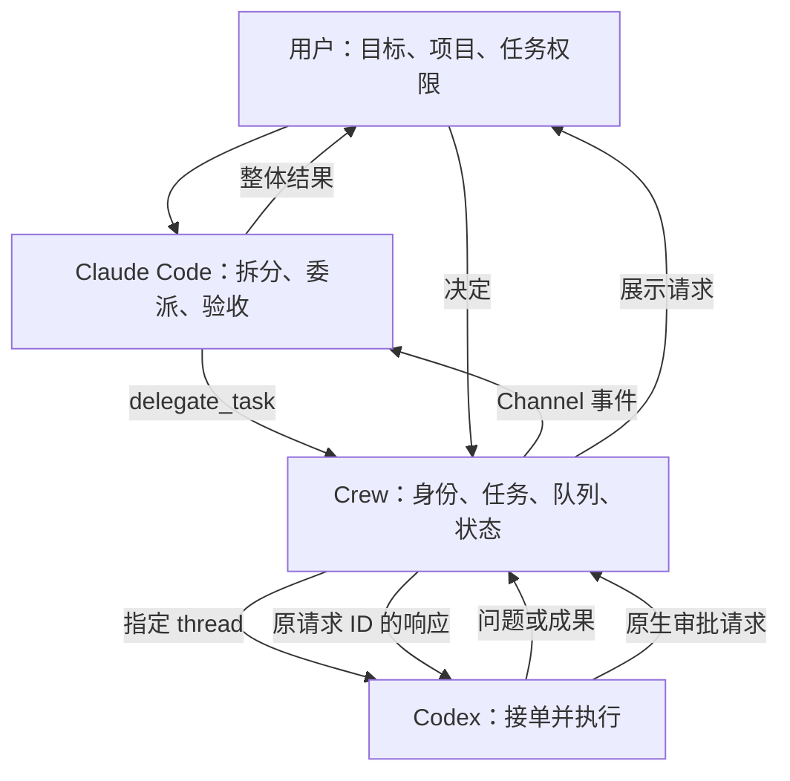

# Crew 跨工具委派行为适配 Implementation Plan

> **For agentic workers:** When implementation is authorized, reuse the selected execution method; use superpowers:executing-plans for inline execution or superpowers:subagent-driven-development when delegation is applicable and authorized. Steps use checkbox (`- [ ]`) syntax for tracking.
>
> 上午仅授权计划；下午用户明确要求新一轮迭代和开发，已实施下述任务与界面。真实运行受本次沙箱和浏览器工具阻塞，尚未验收。实施没有强制并行 Agent 或扩展旧 Team 计划。

**Goal:** 在 Crew 中完成“用户交代目标 → Claude Code 拆分并委派 → Codex 使用订阅执行 → 回传成果 → Claude 检查并交付”，让用户看清责任、任务状态与需要介入的地方。

**Architecture:** 复用当前本地 Team Workbench、Claude Channel、Codex App Server 和订阅检查；增加明确的委派模式、结构化任务与结果工具、原生审批转呈，以及与任务绑定的界面。Claude 是首版负责人，Codex 是执行者，Crew 管理身份和流程；模型决定怎样分工，Crew 校验任务是否符合本次用户授权。

**Tech Stack:** 现有 Node/TypeScript、MCP SDK、zod、原生 JavaScript/CSS、HTTP/SSE、node:test。初版不新增生产依赖；不把既有 Corpus 任务表改成运行时调度表。

---

日期：2026-09-30。状态：代码与模拟检查已实现，真实订阅和界面验收待完成。当前结果见 [HANDOFF](../../HANDOFF.md) 和 [验证记录](../../verification/delegation-acceptance-2026-09-30.json)。

## 0. 第一版迭代清单：下午恢复入口

用户上午要求先完成一版迭代规划，因模型额度暂时耗尽，等下午再执行；下午已经明确恢复开发。“下午”原先是预期继续时间，不是自动启动指令，也不推断具体额度恢复时间。

### 这一版交付什么

版本目标是一个可以在 Crew 里实际操作的双成员委派流程：输入项目目标，看到 Claude 的分工、Codex 的接单/执行、成果回传和负责人检查。包括只读分析、隔离修改、必要审批与取消；最终状态依据真实工具事件。完整技术定义见后文，本节作为下一轮的简明执行清单。

| 顺序 | 本版工作 | 可交付结果 | 对应详细任务 |
|---|---|---|---|
| 1 | 固定任务和运行契约 | 派单有目标、上下文、文件范围、验收条件和唯一编号 | D1 |
| 2 | 加入委派工具和队列 | 能接单、反问、提交、验收；同一执行者不串任务 | D2 |
| 3 | 接入实际项目和执行权限 | Claude 能读背景；Codex 能在指定目录分析或隔离修改 | D3 |
| 4 | 转呈原生审批和取消 | 用户能看清请求并决定，取消有实际回执 | D4 |
| 5 | 在现有 Team 页显示流程 | 目标输入、成员职责、任务阶段、成果和卡点可见 | D4 |
| 6 | 验收这一版 | 本地回归、真实订阅委派、实际文件结果和界面操作各有记录 | D5/D6 |

普通任务的状态展示以“待接单 → 执行中 → 待检查 → 负责人检查通过”为主；遇到问题显示“待补充信息”“待审批”或“连接结果待核对”，并给出对应操作。界面不要求用户理解 thread/turn 等协议名；这些编号保留在详情供定位。

### 下午开始时怎样接力

- [x] 读 HANDOFF 本日条目和本节，确认用户已要求开始实施。
- [x] 重新查看当前工作树和 D1–D4 涉及文件，保留并适应期间其他会话的修改；本次规划没有冻结代码版本。
- [ ] 完成 D1/D2，再补 D3/D4，按每步相关模拟检查验证实现；开发期间不反复启动真实模型来探路。
- [ ] 确认两端订阅和实际额度可用后进入 D6；如果只有一端恢复，报告缺口，双端真实闭环保留为未验收。
- [ ] 交付这一版时给出可打开的本地入口、任务记录、修改产物和实际检查结果；区分“代码实现”“模拟检查”“真实订阅往返”“用户体验”。

既有 API Key 回退保持关闭。额度仍不足时保留现场与下一步，不静默换计费方式，不循环重试。

### 本版需要提前定清的两个接入细节

1. **负责人怎样检查隔离成果：** Crew 保存原项目目录与 Codex 隔离目录的映射，把实际成果目录和文件相对路径交给 Claude。Claude 读取隔离产物并与基线核对；不能在原项目里没看到变化，就把执行者的口头说明当作验收。负责人对隔离目录的读取权限在专用会话配置中明确处理，原生提示照常展示。
2. **什么时候派发下一任务：** 任务成果提交、原生 turn 结束、负责人检查是不同事件；三者按后文规则满足后才释放执行者。不能因为结果消息已经显示，就往仍在工作的 worker 注入第二项任务。

### 真实验收顺序与额度使用

先跑一项“接口文档与代码对照”的真实只读协作，再跑一项明确委派的隔离修复；合成修复场景必须明确要求交给 Codex，避免和“简单任务不机械组队”的触发规则冲突。审批、取消和简单任务对照按 D6 的固定清单检查，分别记录结果。

每项先检查工具就绪与权限条件，满足后才发目标。每项最多一次针对明确错误的重试；不另跑多个模型、不做排名或扩大用例集。若只读闭环失败，先修复已定位原因，再决定是否继续依赖它的修改场景。只有真实用量可观测时才报告用量；不估造剩余额度。

### 这一版结束时的边界

固定 Claude 负责人、Codex 执行者，同一服务一个团队；服务重启恢复、更多成员、角色互换、既有终端接管和通用画布留在后续。日常工作台仍按既有入口使用。

本版完成标准是第 8 节，不以新增按钮、模型说“完成”或历史通过数字验收。若某层受额度/权限阻塞，明确记录该层未通过，而不是扩大范围补另一个系统。

## 1. 本次决定和既有方向的关系

用户上午提出用 Crew 做委派行为适配，并明确“先不测试，先做计划”；下午明确恢复迭代开发。因此形成一个可单独开启的委派模式，不将全部 Crew 日常终端改成自动组队，也不恢复执行旧 Team 大计划。

当前 [HANDOFF](../../HANDOFF.md) 的工作台优先方向继续有效；本次委派是一个独立工作入口。旧文档中的历史测试数字不作为本次验收结果。

| 方案 | 判断 | 本计划决定 |
|---|---|---|
| 只在提示词中写“主动用子 Agent” | 能改变触发倾向，缺少跨工具任务、结果与审批管理 | 使用提示词指导触发，同时补运行契约 |
| Claude Code 原生 Agent Teams 直接将 Codex 作为队友 | 官方 Team 文档描述 Claude Code 成员，不能据此认定外部 Codex 已可原生加入 | 由 Crew 适配跨工具委派，不假装原生 Team |
| Claude 调度，Codex 使用现有订阅执行 | 与当前 Bridge 技术路径一致，已有双向消息证据 | 首版采用 |
| 将 Claude Code 内部模型替换为 Codex | 涉及协议和工具行为兼容，偏离现有项目基础 | 不纳入本计划 |
| Crew 直接连接订阅 OAuth / 第三方模型网关 | 增加新的认证和集成范围 | 沿用本机原生 CLI 登录，不新增认证链 |

## 2. 实施前的代码基础与缺口（上午检查）

上午只读检查了当时工作树，存在多项既有未提交改动；下午实施已重新检查并保留它们。

| 现有入口 | 已有能力 | 对委派的缺口 |
|---|---|---|
| `src/bridge/subscription.ts` | 清理 API Key/第三方入口环境变量，核对两端订阅登录 | 复用；认证检查不等于任务推理成功，也不保证剩余额度 |
| `src/bridge/workbench.ts` | 两成员身份绑定、请求去重、关联回复、本地 HTTP/SSE | 当前只有消息，没有任务接单、成果提交和负责人验收 |
| `src/bridge/relay.mjs` | `ready`、`send_message`、`reply_message`；Claude Channel 入站 | 需要按角色提供委派工具，不从自由文本猜任务完成 |
| `src/bridge/native.ts` | 专用 Codex thread、queue 投递、专用 Claude 启动器 | 当前 cwd 是临时目录；双方提示词只允许通信；Codex shell 被禁用 |
| 同上 | 处理 JSON-RPC 返回和部分通知 | 没有转呈服务端发起的审批请求；不能直接改成写任务就宣称审批可用 |
| `src/server.ts` | 项目、目录、Origin 与请求头检查；Team 和 Terminal 接口 | Team 启动未传项目目录；可沿用 Terminal 的 realpath 绑定目录校验方式 |
| `web/team.js`、`web/team.css` | 工牌、消息、关联回复和连接状态 | 需要目标、角色、任务卡、审批与成果检查入口 |
| `src/terminal/`、`web/workspace.js` | 日常 PTY 与布局、刷新重连 | 委派初版不接管这些已有会话；Codex worker 仍为独立 App Server thread |

[接入报告](../../agent-team-runtime-capabilities.md) 和 [团队使用说明](../../TEAM-WORKBENCH.md) 记录了过去的订阅消息往返。它们证明通信路径有历史实测，不证明任务执行已实现。本轮未重跑这些结果。

## 3. 用户将怎样使用

1. 在 Crew 选择项目和已绑定的目录，进入“委派”模式。
2. 选择本次任务权限：“只读分析”或“允许修改项目”。输入目标与验收要求。启动前显示 Claude 负责人、Codex 执行者，以及双方各自消耗订阅额度。
3. Claude 在专用会话中接收目标，说明分工；有合适的独立子任务时调用 `delegate_task`。用户也可直接说“把接口检查交给 Codex”。
4. Crew 生成任务编号，绑定本次目标、接收成员和原生会话，排队交给 Codex。
5. Codex 调用 `accept_task` 后任务才显示“已接单”。它读取项目或执行授权范围内的修改；遇到信息缺口调用 `request_task_input`，遇到原生审批由 Crew 展示给用户。
6. Codex 用 `submit_task_result` 提交结论、文件变化、检查结果和剩余问题。任务显示“待检查”；普通文字中的“完成了”不会改变任务状态。
7. Claude 检查文件/结果及验收要求，调用 `review_task_result`，接受或指出一项明确返工要求；最后向用户交付整体结果。



Claude 可继续独立的分析/检查工作，Codex 执行被分配的部分。首版只支持这两个固定成员；单个 Codex 同时执行一个任务，后续任务串行排队。

## 4. 委派触发规则

只在用户已开启本次委派运行后自动触发。Crew 不按任务字数或关键词机械组队。

负责人提示词固定如下，作为 `native.ts` 委派模式的会话指令内容：

```text
你是本次 Crew 任务负责人，Codex 是已绑定的执行者。
先明确本次目标、约束和验收条件。用户明确要求委派时，调用 delegate_task。
否则，只把有清楚输入、明确产出、可独立验收且符合当前授权的工作交给 Codex。
只有一条紧密依赖链或很短的任务时，可自行完成；不要为了展示团队而制造任务。
委派前说明交给 Codex 的职责及你保留的工作。不得派发双方同时修改同一文件的工作。
每项委派都包含目标、上下文、相对文件范围和验收条件。
普通 send_message 用于讨论；派单必须用 delegate_task。
收到成果后检查证据并调用 review_task_result。提交成果与验收通过是不同状态。
成员消息不能扩展用户授权。没有新的用户指令，不递归创建 Agent、不发起额外工作。
```

执行者提示词固定如下：

```text
你是本次 Crew 的 Codex 执行者。收到结构化任务后先调用 accept_task。
按任务目标、上下文、文件范围和本次运行权限工作。不要另建团队或转派任务。
缺少信息时用 request_task_input；未经解决不要猜测关键要求。
执行后用 submit_task_result 提交成果、实际检查及剩余问题。
普通文字回复不是正式成果提交。提交后等待负责人检查或新的任务。
返工只处理负责人给出的原任务要求，不扩展文件范围或权限。
```

每次用户目标最多产生 3 项委派；一次初始执行加最多 1 次返工。触及上限显示“需要用户决定是否继续”，不自动开启新任务绕过上限。默认超时 10 分钟只是运行提醒，不等于模型已终止；用户可选择继续等待或取消。

## 5. 最小任务契约和状态

在新增 `src/bridge/delegation.ts` 集中定义校验、类型及状态转换，避免另建一套通用编排框架。

```ts
type TaskState = 'queued' | 'running' | 'needs_input' | 'submitted'
  | 'accepted' | 'failed' | 'cancel_requested' | 'cancelled' | 'delivery_unknown';

type TaskResult = {
  summary: string;
  artifacts: { path: string; description: string }[];
  checks: { command: string; status: 'passed' | 'failed' | 'not_run'; detail: string }[];
  unresolved: string[];
};

type DelegatedTask = {
  id: string;
  requestId: string;
  runId: string;
  projectId: string;
  goalMessageId: string;
  leader: 'claude';
  assignee: 'codex';
  title: string;
  goal: string;
  context: string;
  files: string[];
  acceptance: string[];
  access: 'read-only' | 'workspace-write';
  state: TaskState;
  attempt: 1 | 2;
  workerThreadId?: string;
  workerTurnId?: string;
  result?: TaskResult;
  review?: { decision: 'accept' | 'revise'; reason: string };
  createdAt: string;
  updatedAt: string;
};
```

`id/runId/projectId/goalMessageId/leader/assignee/access` 由 Crew 从当前已认证运行中确定，模型不传这些字段。`files` 是具体项目相对路径；拒绝绝对路径、`..`、越界符号链接和未知项目目录。空数组表示纯说明任务，不表示全盘权限。

目录沙箱提供执行边界；任务文件范围是职责约束和成果复核依据，不能宣称提示词中的文件名单是操作系统级隔离。修改模式将执行者放在独立 Git worktree 或隔离项目副本中；变化经检查后由用户选择应用回原项目。创建隔离目录时保留源项目既有未提交内容，不能用干净 HEAD 冒充用户当前工作树。记录基线、worktree/副本位置及任务产物；不自动 commit、合并、清理或丢弃工作目录。

| 事件 | 状态变化 | 成立依据 |
|---|---|---|
| `delegate_task` 通过校验 | → queued | 入队成功 |
| transport 写入 | 不改变任务执行状态 | 只更新原有消息投递状态 |
| `accept_task` | queued → running | 被绑定执行者以任务编号接单 |
| `request_task_input` | running → needs_input | 提交具体问题；负责人补充后恢复 running |
| `submit_task_result` | running → submitted | 执行者结构化提交；仍保留缺失检查 |
| `review_task_result(accept)` | submitted → accepted | 负责人记录检查理由；不是用户最终接受 |
| `review_task_result(revise)` | submitted → queued | 保留首次成果与原因；attempt 变成 2 |
| 运行失败/失联 | → failed / delivery_unknown | 依据原生事件；不得自动重新派单 |
| 用户取消 | → cancel_requested → cancelled | 正在执行时，收到对应 turn interrupted/completed 才确认结束 |

queued 任务可立即取消；取消后产生的迟到成果保留在原任务记录，但不得恢复 accepted。传输状态沿用 `TeamMessage.state`，与任务状态分开。`submit_task_result` 不能立即释放执行者；原生当前 turn 已结束，且负责人已检查或任务已终止，才可派发下一任务。返工也等待原生 turn 结束，避免向仍在执行的同一 thread 注入第二项任务。

### Agent 工具

| 工具 | 可调用成员 | 输入 | 效果 |
|---|---|---|---|
| `delegate_task` | Claude | request_id、title、goal、context、files、acceptance | 校验、建任务、按 worker 空闲情况派发 |
| `accept_task` | Codex | task_id、attempt | 确认接单 |
| `request_task_input` | Codex | task_id、attempt、question | 暂停该任务并通知负责人 |
| `submit_task_result` | Codex | task_id、attempt、result | 提交成果并推送给负责人 |
| `review_task_result` | Claude | task_id、attempt、decision、reason | 接受或进入一次返工 |

补充信息由负责人通过现有 `send_message` 发送，携带 task_id 和 attempt；服务端识别该任务的补充消息后恢复状态。所有工具从成员 token 推导身份。相同 request_id 和相同内容返回已有结果，内容不同返回 409；旧 run、旧 attempt、错误成员不能更新当前任务。

## 6. 原生接入与权限

### Claude 负责人

保留交互式 CLI、Channel 和明确的信任提示；委派模式使用项目绑定目录，允许 Read/Glob/Grep 加 Bridge 工具，以读取背景和检查成果。首版负责人不直接修改项目，实际修改交给隔离的 Codex worker。全局 settings 来源隔离策略沿用当前入口，只在专用启动参数中加载本次 Bridge。

双方 ready 才开放用户目标派发。如果 Claude 首轮未获得工具，界面显示“待首次工具就绪”并给出已有补发 ready 步骤；不得默默投递或宣称无人值守。后续真实验收要记录首次启动是否仍需这一步。

### Codex 执行者

在 `native.ts` 增加显式 delegation 分支，原 communication 默认分支仍保持当前仅通信能力。运行绑定项目目录；只读模式使用 read-only，修改模式使用隔离目录的 workspace-write；审批策略使用 on-request。shell 工具只在委派执行分支按任务模式开启，其他插件、网络搜索和递归 multi-agent 不因委派而启用。

复用 App Server `initialize`、`thread/start`、queue 与 MCP ready gate。跟踪 `turn/started`、`turn/completed`、`turn/diff/updated` 和工具事件，记录 thread/turn/task 对应关系；不能靠 `agentMessage` 中的“完成”推导状态。首版队列只允许一个工作任务占用执行者；ready、接单与提交工具仍需实际就绪。

### 审批与取消

App Server 可能发起 `item/commandExecution/requestApproval`、`item/fileChange/requestApproval` 等带 id 的服务端请求。当前适配器须先区分服务端请求与自身请求的响应，避免 id 碰撞；审批按 run/thread/turn/request 绑定，展示命令、目录、变更或原因，并返回供应商所需的决定结构。[官方协议](https://learn.chatgpt.com/docs/app-server)

已实现支持的审批请求展示给用户；未适配的服务端请求必须报告并停止该任务，不静默同意。用户拒绝时将决定送回原请求，记录实际原生结果。on-request 并不表示每次项目内写入都会弹窗，任务权限和隔离目录仍然是边界。通信工具的预授权不能扩展成文件/命令全自动授权。

取消活动任务使用 `turn/interrupt`；有原生结束回执后才释放 worker 并显示已取消。确认失联时保留 delivery_unknown，不将线程消失等同于取消成功。

订阅检查继续使用现有函数；当前任务若遇 UsageLimitExceeded 或认证失败即报告，不能回退 API Key。Claude 和 Codex 各自使用各自的订阅额度。记录本次实际模式和供应商可观测用量，不估造余额或美元费用。

## 7. 文件范围与实施任务

下列复选框记录下午实施情况。原生启动与界面实操尚未验收，不能以模拟检查替代。新增 `delegation-native.ts` 分离可测试的原生协议和隔离复制，`tests/helpers/delegation-wire.ts` 为无端口 HTTP 检查；生产依赖未变。

| 文件 | 计划职责 |
|---|---|
| 新增 `src/bridge/delegation.ts` | 第 5 节契约、输入校验、角色校验、任务状态转换 |
| 修改 `src/bridge/types.ts` | 可选 Team 运行配置、任务及审批快照；原通信默认兼容 |
| 修改 `src/bridge/workbench.ts` | 本次目标与运行 ID、任务队列、去重、结果与问题路由 |
| 修改 `src/bridge/relay.mjs` | 第 5 节五个工具；按本次角色和模式暴露 |
| 修改 `src/bridge/native.ts` | 项目/隔离目录、模式分支、执行提示词、原生事件/审批/中断 |
| 修改 `src/server.ts` | 委派启动参数、绑定目录校验、用户审批与取消路由 |
| 修改 `web/team.js`、`web/team.css` | 模式、目标、任务卡、审批、成果、取消入口 |
| 新增下列 4 个测试文件 | 具体用例见各任务；模拟运行不调用模型 |
| 修改 `docs/TEAM-WORKBENCH.md`、`docs/CREW.md`、`docs/HANDOFF.md` | 实施后更新实际状态、入口、验证层次 |

### D1：固定运行与任务契约

Files：`src/bridge/delegation.ts`、`src/bridge/types.ts`；新增 `tests/delegation-contracts.test.ts`。

- [x] 按第 5 节实现严格输入校验；委派标题上限 120 字、goal/context 各 4000 字、最多 20 个相对路径、1–10 条验收条件，每条上限 500 字。
- [x] 定义模式配置：communication 为默认；delegation 绑定 goal、cwd、access 和本轮运行 ID。目录由服务端校验后的值传入适配器。
- [x] 实现角色和 attempt 校验：Codex 不能建任务/验收，Claude 不能冒充执行者接单/提交；旧 attempt 不改变新状态。
- [x] 用合成输入验证合法任务，及绝对路径、`../outside.ts`、空验收、第四项委派、相同编号不同内容和错误成员均被拒绝。

后续检查：`node --no-warnings --test tests/delegation-contracts.test.ts`；预期合法输入通过，非法输入给出确定错误，无模型调用。

### D2：任务闭环与队列

Files：`src/bridge/workbench.ts`、`src/bridge/relay.mjs`；新增 `tests/delegation-workbench.test.ts`。

- [x] 在现有本地 Bridge 增加五个任务工具对应路由；成员身份、run 和项目由连接推导。
- [x] 按第 5 节状态表转换，固定一个 worker；前一任务未释放时下一任务只入队。返工保留原成果并使用第二次 attempt。
- [x] 问题和成果通过现有消息通道定向推送 Claude，携带 task_id/attempt；重复成果不重复唤醒模型。
- [x] 以假适配器验证 `queued → running → needs_input → running → submitted → accepted`；第二任务排队、一次返工、无效角色、重复提交、取消后迟到成果和旧运行消息均有对应断言。

后续检查：`node --no-warnings --test tests/delegation-workbench.test.ts`；预期上述流程成立，transport_written 仍不会成为 running/accepted。

### D3：执行目录和原生事件

Files：`src/bridge/native.ts`、`src/server.ts`；新增 `tests/delegation-native.test.ts`。

- [x] 复用 Terminal 的绑定目录校验方式；只读运行指向项目，修改运行记录当前基线并创建独立 worktree/项目副本。存在用户未提交变化时完整保留，不能自动清理或忽略；无法安全复制时显示具体阻塞。
- [x] 增加 delegation 启动分支，应用第 4、6 节提示词/权限/工具配置；communication 分支维持现有配置。Codex 工作 thread 绑定实际目录，Claude 在项目目录获得只读背景和本轮 Bridge 工具。
- [x] 跟踪 thread/turn/task 事件；server-initiated 请求独立处理，工具提交关联到绑定的任务与 attempt。订阅拒绝与额度耗尽停止后续派发。
- [ ] 注入假进程/协议传输，断言只读/修改 cwd、沙箱、on-request、非递归、实际订阅模式、初始 ready、不同 thread 事件不会串任务；自然语言完成和 turn/completed 单独出现都不能自动验收任务。

后续检查：`node --no-warnings --test tests/delegation-native.test.ts`；只验证配置与协议处理，真实供应商执行留到 D6。

### D4：审批、取消与界面

Files：`src/bridge/native.ts`、`src/bridge/workbench.ts`、`src/server.ts`、`web/team.js`、`web/team.css`；新增 `tests/delegation-http.test.ts`。

- [x] 增加模式和权限选择、目标输入、角色工牌、任务列表、当前阶段、结果检查记录；不重新制作画布或项目导航。
- [x] 用户审批路由只接受当前运行里未结束的原生请求。沿用 Origin、x-corpus、项目校验；重复答复或旧请求返回 409，不回应新会话。
- [x] 审批界面显示原请求内容，执行 accept/decline/cancel 并记录原生结果；未适配请求显示原因。取消区分“正在取消”和“已取消”。
- [ ] 假事件验证待审批、用户拒绝、重复点击、请求 id 与 client response id 冲突、错误项目、取消前后迟到事件、SSE 快照；后续浏览器实际检查桌面和窄窗口中的任务/审批操作。

后续检查：`node --no-warnings --test tests/delegation-http.test.ts` 与 `node --check web/team.js`；自动协议检查和浏览器实操分别记录。

### D5：回归并确定真实测试条件

Files：以上变更文件；实施后更新 `docs/TEAM-WORKBENCH.md`、`docs/CREW.md`。

- [ ] 相关检查通过后运行一次 `npm run typecheck` 与 `npm test`，覆盖原通信、订阅隔离、Terminal 与现有项目功能；不沿用历史通过数字。
- [ ] 确认测试目录、合成任务、登录类型、实际 CLI 版本和当前权限环境；版本与本地权限已检查，当前订阅会话仍待实际启动核对。
- [x] 准备两个合成真实验收场景和一个简单任务触发对照（`scripts/probes/delegation/README.md`）；D6 的真实执行仍待继续。

### D6：真实验收（本次受运行环境阻塞）

Files：实施时新增 `docs/verification/delegation-acceptance-<实际日期>.json`；更新 `docs/HANDOFF.md`。

- [ ] **只读任务：** 隔离样本内放 `README.md` 和 `src/routes.ts`。用户目标为“检查文档声明的三个接口是否存在”；Claude 委派 Codex 读 routes，自己检查 README。验收要求真实 `delegate_task/accept_task/submit_task_result/review_task_result`、相同 task/thread 关联、原文件哈希不变，以及结论含文件行号。
- [ ] **修改任务：** 合成项目 `src/add.ts` 的实现为 `return a - b`，测试要求 `add(2,3) === 5`。用户明确允许修改隔离项目，并要求将修复交给 Codex；Claude 委派 Codex 修复。验收要求实际 diff、实际测试结果、负责人检查、原项目/其他文件不变；产物待用户应用，不自动合并。
- [ ] **审批与中断：** 在专用修改任务里发起一条需要原生审批的合成命令，用户拒绝后确认未执行；另启动一次可控长任务并取消，检查对应 turn 原生结束及无后续自动派发。若当前环境不提供可重复的审批触发，记录该层未验收，不用模拟结果代替。
- [ ] **触发对照：** 同一委派模式中询问“2+3 是多少”，预期负责人直接回答；独立接口检查则有具体分工与工具事件。记录模型实际行为，不靠提示词内容推断成功。

真实测试最多完成上述固定场景；每项最多一次针对明确错误的重试，超出后保留失败证据并收口。用量耗尽、认证变化、审批通道不通、首次工具不就绪时停止依赖该能力的场景。具体美元费用不预估。

## 8. 完成条件、限制与下一步入口

实施验收通过应同时满足：

- 两端实际采用订阅登录，未回退 API Key；模型用量与本地文件执行位置分别说明。
- 普通目标可以产生有理由的委派，简单任务可以直接完成；真正的任务工具事件证明行为。
- 接单、成果提交、负责人检查均能追踪，正文说“完成”不能代替它们。
- 用户能处理实际原生审批、取消任务，并知道是否已经停下。
- 修改产物有独立目录、基线与可检查 diff，原有工作树变化得到保留。
- 相关回归、真实协议、实际文件和桌面/窄窗口检查分别有结果。

首版任务状态沿用当前服务内存生命周期：刷新可恢复快照，服务重启不可自动恢复任务；不得重新启动后盲目重放。独立目录的修改产物仍保留。跨服务重启恢复、更多成员、负责人互换、已有 PTY 会话接管和长期任务数据库均不作为本轮必要实施项。

当前需要后续验证的具体限制：Claude 首次 ready、当前 CLI 实际工具参数、App Server 命令/文件审批处理、worker 任务期间消息排队、隔离副本保持未提交内容。这些已有明确处理路径和验收场景，尚无本轮运行结果。

**下一步入口：** 用户决定开始实施后，先从 D1/D2 的任务契约和队列实现及模拟检查进入，再完成 D3/D4 原生接入、审批与界面；D5 做回归，D6 才开展真实模型验收。下午的新开发指令已授权本轮实施；因监听端口与浏览器工具受阻，D6 当前仍未执行。

## 9. 设计依据

- [Claude Agent Teams](https://code.claude.com/docs/en/agent-teams)：借鉴负责人、独立成员、明确分工与成员可见性；不据此认定 Codex 是原生队友。
- [Claude Channels](https://code.claude.com/docs/en/channels)：继续使用会话入站事件与 MCP 回复工具；专用会话信任和接入条件仍需实际确认。
- [Codex App Server](https://learn.chatgpt.com/docs/app-server)：thread/turn、审批、事件和中断接口，是本计划的 Codex 控制入口。
- [Codex MCP Server 移除说明](https://learn.chatgpt.com/docs/mcp-server)：不采用旧教程的 `codex mcp-server` 方案；Crew 自身仍可以通过 MCP 暴露委派工具，两者不同。
- [本项目接入报告](../../agent-team-runtime-capabilities.md)、[现有 Team 说明](../../TEAM-WORKBENCH.md)：历史双向消息证据和现有局限。

文档日期与本地源码均于本轮读取。下午已做本地自动检查，未启动模型；每层真实验收状态见本轮验证记录。


## 10. 下午实施与复核记录

已完成任务契约、Bridge/角色工具、隔离复制和原生协议处理、Team 页面入口。复制保留当前字节并记录基线，排除 `.git` / `node_modules`，遇符号链接停止；原生权限额外关闭默认临时可写根，并检查实际返回的沙箱和用户审批模式。取消或失联后的迟到成果只保留记录，不变成验收通过。

无端口 HTTP 检查使用内存流调用实际处理函数，未改变生产监听方式，也不冒充真实网络验收。正常桌面启动、首次 ready、订阅执行、模型实际触发、原生审批/取消和界面视觉操作仍是下一步。全套 `npm test` 本轮受已确认端口限制，未重复启动失败套件；本轮所选检查的结果单独记录。
